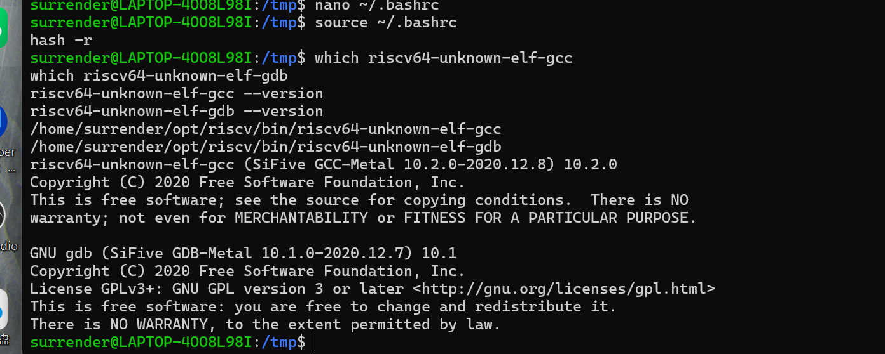
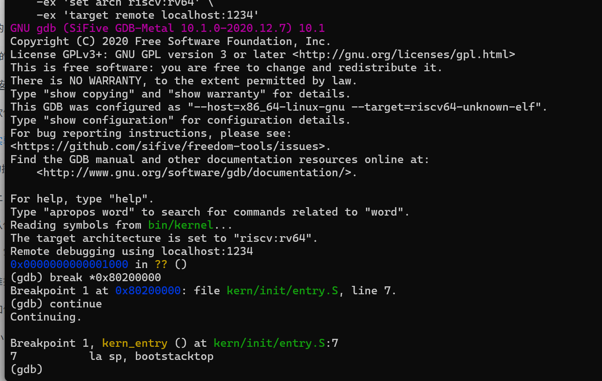
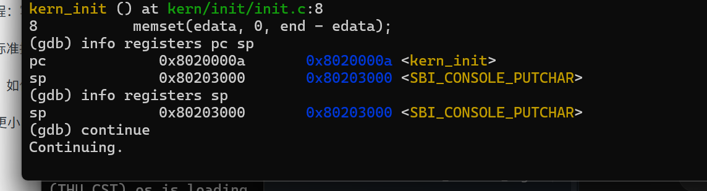

# 操作系统实验报告

## 实验基本信息

| 项目 | 内容 |
|------|------|
| 实验名称 | Lab 1：比麻雀更小的麻雀（最小可执行内核） |
| 小组成员 | 2411843-王鹏钧、2412854-于子朔、2412855-张雅程 |
| 初次实验日期 | 2026-10-08 |
| 补充复核日期 | 2026-10-10 |
| 报告整理日期 | 2026-10-11 |

### 小组分工

| 成员 | 负责的练习/模块 | 主要成果 |
|------|----------------|----------|
| 2411843-王鹏钧 | 练习一：理解内核启动中的程序入口操作 | 分析 `entry.S`、启动栈及尾调用，完成练习一说明 |
| 2412854-于子朔 | 练习二 A：环境配置与复位引导分析 | 工具链配置、编译及启动故障定位；分析 `0x1000` 的六条复位指令；整理环境与复位阶段记录 |
| 2412855-张雅程 | 练习二 B：固件交接与内核入口验证 | 核对 OpenSBI 交接机制、入口断点及 PC/SP 变化；分析观察点适用范围；整理验证表、问题回答与结论 |

练习二由于子朔与张雅程共同负责：于子朔侧重环境配置和复位引导，张雅程侧重固件交接和内核入口验证。两部分均包含调试分析、结果整理和报告撰写，工作量相近。调试截图作为小组共同实验材料；下表说明责任划分，不以截图数量衡量个人工作量。

| 工作项 | 于子朔：练习二 A | 张雅程：练习二 B |
|--------|----------------|----------------|
| 环境/源码核对 | 核对 GCC、GDB、QEMU 版本和两个启动目标 | 核对链接入口、`entry.S`、`init.c` 与符号地址 |
| 调试操作 | 连接复位状态，检查指令和启动参数 | 检查固件入口、内核断点和入口单步过程 |
| 原理分析 | 逐条解释复位指令和参数来源 | 解释固件交接、PC/SP 变化和观察点限制 |
| 问题处理 | 整理加载参数、PATH、断点未命中的排查 | 复核排查结论，说明伪指令、符号显示与无限循环现象 |
| 报告成果 | 完成实验环境、故障处理、阶段一和复位指令表 | 完成阶段二至四、问题回答、验证结果与练习二总结 |

---

## 一、实验目的

1. 搭建 RISC-V 64 位交叉编译与模拟运行环境，理解在 x86 主机上编译、运行 RISC-V 内核的方法。
2. 理解 QEMU 复位引导、OpenSBI 固件初始化和内核入口之间的控制权交接。
3. 分析 `la sp, bootstacktop` 和 `tail kern_init` 的操作及其作用，理解执行 C 代码前建立启动栈的必要性。
4. 使用 QEMU 的远程调试接口和 GDB，观察从复位地址 `0x1000` 到内核入口 `0x80200000` 的启动流程。
5. 理解链接脚本、ELF 文件、原始内核镜像及 SBI 控制台输出之间的关系。

---

## 二、实验环境

### 2.1 软件与工具

| 项目 | 本次实验环境 |
|------|--------------|
| 宿主系统 | Windows，使用 WSL 2 |
| Linux 发行版 | Ubuntu 22.04 |
| 交叉编译器 | SiFive GCC-Metal 10.2.0-2020.12.8，GCC 10.2.0 |
| 调试器 | SiFive GDB-Metal 10.1.0-2020.12.7，GDB 10.1 |
| 模拟器 | QEMU 6.2.0（Ubuntu 软件包） |
| 固件 | QEMU 默认 OpenSBI v0.9，Runtime SBI Version 0.2 |
| 模拟平台 | `virt`，RISC-V 64 位 |
| 工具链安装目录 | `$HOME/opt/riscv` |
| 当前完整源码目录 | `lab1\code` |

上表记录原实验截图使用的工具链。2026-10-10 的补充复核使用系统 GCC 10.2.0、显式指定的 `/usr/bin/qemu-system-riscv64` 6.2.0，以及本机 GDB 16.3.90.20250610-git。复核时在独立源码副本中重新编译，所得原始镜像与当前代码目录中的 `bin/ucore.img` 逐字节一致，因而后文的入口地址和寄存器记录对应当前源码。原截图与补充日志分别保留各自的工具版本。

在 `~/.bashrc` 末尾添加：

```bash
export RISCV="$HOME/opt/riscv"
export PATH="$RISCV/bin:$PATH"
```

执行以下命令使配置生效并验证：

```bash
source ~/.bashrc
hash -r
which riscv64-unknown-elf-gcc
which riscv64-unknown-elf-gdb
riscv64-unknown-elf-gcc --version
riscv64-unknown-elf-gdb --version
```

实际路径和版本输出如下：

```text
/home/surrender/opt/riscv/bin/riscv64-unknown-elf-gcc
/home/surrender/opt/riscv/bin/riscv64-unknown-elf-gdb
riscv64-unknown-elf-gcc (SiFive GCC-Metal 10.2.0-2020.12.8) 10.2.0
GNU gdb (SiFive GDB-Metal 10.1.0-2020.12.7) 10.1
```

### 2.2 AI 工具

| 成员 | AI 编程工具 | 底层模型 | 备注 |
|------|------------|---------|------|
| 2411843-王鹏钧 | Codex 桌面应用 | GPT-6.1 | 辅助理解入口汇编 |
| 2412854-于子朔 | Codex 桌面应用 | GPT-6.1 | 辅助环境配置、故障定位及调试结果分析 |
| 2412855-张雅程 | Codex 桌面应用 | GPT-6 Astra | 辅助固件交接分析、结果复核与报告整理 |

---

## 三、实验整体逻辑分析

### 3.1 本章节的逻辑主线

本章围绕“让一个最小内核启动并输出信息”展开。首先通过交叉编译器生成 RISC-V 机器码，再通过链接脚本确定内核入口和内存布局，随后使用 QEMU 模拟硬件和 OpenSBI 提供固件运行环境。控制权进入内核后，由汇编入口建立启动栈，再转入 C 初始化函数，最终通过 SBI 输出启动信息。最后使用 GDB 验证这条执行链，而不只根据终端打印判断启动是否成功。

本次配置下的执行顺序为：

```text
QEMU 复位引导代码（0x1000）
    → OpenSBI 固件（0x80000000）
    → kern_entry（0x80200000）
    → 设置启动栈
    → kern_init（0x8020000a）
    → 执行零值数据区初始化逻辑并打印启动信息
    → 无限循环
```

### 3.2 功能的逐步实现与验证

1. 配置交叉编译器、QEMU 和 GDB，为编译、运行与观察内核提供工具。
2. 使用 Makefile 编译 C 和汇编源文件，通过 `tools/kernel.ld` 将内核链接到 `0x80200000`，生成带调试符号的 `bin/kernel`。
3. 使用 `objcopy` 生成原始二进制镜像 `bin/ucore.img`，供 QEMU 加载。
4. 修正 QEMU 启动参数，确保 OpenSBI 得到正确的后续执行地址，验证启动输出。
5. 分析 `entry.S`，理解启动栈与 C 函数入口之间的关系。
6. 使用 GDB 从复位状态设置入口断点，再单步观察伪指令对应的机器指令和寄存器变化。

### 3.3 核心文件与模块

| 文件或模块 | 主要作用 |
|------------|----------|
| `Makefile`、`tools/function.mk` | 管理编译、链接、镜像生成及 QEMU/GDB 启动 |
| `tools/kernel.ld` | 指定 `ENTRY(kern_entry)`，设置基地址 `0x80200000`，组织代码和数据段 |
| `kern/init/entry.S` | 预留启动栈，设置 `sp`，跳转到 `kern_init` |
| `kern/mm/memlayout.h` | 定义启动栈大小，本代码为两个页面 |
| `kern/init/init.c` | 清零 `edata` 到 `end` 的区域，打印启动信息并进入无限循环 |
| `kern/libs/stdio.c`、`libs/printfmt.c` | 提供 `cprintf` 和格式化输出 |
| `kern/driver/console.c` | 将字符输出交给 SBI 控制台接口 |
| `libs/sbi.c` | 通过 `ecall` 请求 OpenSBI 提供的服务 |

---

## 四、实验内容与实现

### 4.1 练习一：理解内核启动中的程序入口操作

**负责人：** 2411843-王鹏钧。

#### 任务描述

阅读 `kern/init/entry.S`，结合内核启动流程，说明 `la sp, bootstacktop` 和 `tail kern_init` 完成的操作及目的。本练习是阅读分析任务，无需补写入口代码。

#### 练习一提示词

```text
我阅读 entry.S 发现，kern_entry 只有两条指令 la sp, bootstacktop 和
tail kern_init，后面还有 .space KSTACKSIZE 预留空间，而且末尾定义了
bootstacktop。推测第一条指令是在设置内核启动时使用的栈，第二条是在进入
内核初始化函数，但我不理解栈指针为什么指向这个位置，还有这里使用 tail
而不是 call 的原因。结合我的推测进行解释。
```

#### 分析结果

内核启动时，控制权交给汇编入口 `kern_entry`，入口代码先建立内核栈，再进入初始化函数：

```asm
kern_entry:
    la sp, bootstacktop
    tail kern_init
```

`la` 是加载地址的伪指令，将符号 `bootstacktop` 的地址写入栈指针寄存器 `sp`，并不是读取该地址中的数据。文件末尾预留了启动栈空间：

```asm
bootstack:
    .space KSTACKSIZE
bootstacktop:
```

其中 `bootstack` 是这段空间的低地址起点，`bootstacktop` 是高地址端。由于 RISC-V 调用约定中的栈向低地址增长，把 `sp` 设置为 `bootstacktop` 就建立了一个初始为空的内核栈。这为后续 C 函数执行提供有效的栈空间，用于保存局部变量、寄存器和函数调用信息。

本实验的 `KSTACKSIZE` 为两个页面，即 8192 字节。实际调试中，`sp` 从固件留下的 `0x80017ee0` 变为内核启动栈顶 `0x80203000`，验证了该指令的作用。

`tail kern_init` 是尾调用伪指令，将执行流转移到 `kern_init`，但不会像 `call` 那样为此次调用把新的返回地址写入 `ra`。`kern_init` 被声明为 `__attribute__((noreturn))`，最后进入无限循环，因此无需返回 `kern_entry`，使用 `tail` 符合这一控制流。

#### 实际机器指令与验证

本次构建的反汇编为：

```text
0x80200000 <kern_entry>:     auipc sp,0x3
0x80200004 <kern_entry+4>:   mv    sp,sp
0x80200008 <kern_entry+8>:   j     0x8020000a <kern_init>
```

这里 `la` 对应 `auipc sp,0x3` 和 `addi sp,sp,0` 两条 32 位指令；GDB 把后一条显示为别名 `mv sp,sp`。第一条计算 `0x80200000+0x3000=0x80203000`，第二条低位偏移为零。禁用反汇编别名后，末条实际指令为 16 位压缩跳转 `c.j`（机器码 `a009`），因此下一条 `kern_init` 的地址是 `0x8020000a`。这是本次构建经链接松弛后的结果；`tail` 的通用展开形式不能固定认为总是一条 `j`。因此 GDB 的 `si` 每次执行一条机器指令，不能把一次 `si` 等同于执行完一条汇编伪指令。

本练习为阅读分析任务，入口代码无需修改。栈初始化和尾跳转的结论通过练习二的断点、单步和寄存器记录得到验证。

### 4.2 练习二：使用 GDB 验证启动流程

**共同负责人：** 2412854-于子朔、2412855-张雅程。于子朔负责练习二 A，张雅程负责练习二 B。

#### 任务描述

从 QEMU 模拟的 RISC-V 加电复位开始，观察最初的执行地址与指令，验证固件向 `0x80200000` 内核入口移交控制权，并记录调试过程、观察结果和结论。

#### AI 协作说明

本次采用多轮交互：先提供实验要求、源码路径和课程资料，再提供环境版本、启动输出及 GDB 操作结果，请 AI 帮助解释现象与定位问题。下列文本是对实际需求的整理，不作为当时逐字输入的历史记录：

```text
请根据 lab1 的 entry.S、Makefile 和实际终端输出，指导我在 Ubuntu 22.04
WSL 中用 QEMU 和 SiFive GDB 跟踪从复位地址到内核入口的过程。小组三人需要
统一工具链版本。请解释启动停在 OpenSBI、GDB 命令不存在以及断点未命中的
原因，并结合单步输出说明 PC、SP 和伪指令展开情况。
```

#### 练习二 A：环境与启动问题处理（于子朔负责）

**问题一：内核已编译，但只有 OpenSBI 输出。**

原 Makefile 使用：

```make
-device loader,file=$(UCOREIMG),addr=0x80200000
```

终端显示 `Domain0 Next Address : 0x0000000000000000`，且没有内核启动信息。在本次 QEMU 6.2.0 与默认 OpenSBI 的组合下，这种加载方式没有正确配置固件的后续入口。将 `qemu` 和 `debug` 两个目标都改为：

```make
-kernel $(UCOREIMG)
```

随后成功输出 `(THU.CST) os is loading ...`。`debug` 目标保留 `-s -S`：

```make
debug: $(UCOREIMG) $(SWAPIMG) $(SFSIMG)
	$(V)$(QEMU) \
		-machine virt \
		-nographic \
		-bios default \
		-kernel $(UCOREIMG) \
		-s -S
```

`-s` 等价于 `-gdb tcp::1234`，在 TCP 1234 端口开启 GDB 服务，`-S` 在启动时暂停 CPU。因此执行 `make debug` 后暂时没有输出属于正常等待状态。

**问题二：`make gdb` 找不到调试器。**

最初的系统工具包可以编译内核，但没有提供 Makefile 调用的 `riscv64-unknown-elf-gdb`，报错为：

```text
make: riscv64-unknown-elf-gdb: No such file or directory
make: *** [Makefile:177: gdb] Error 127
```

为统一团队环境，安装 SiFive 预编译工具链并配置 PATH。之后 GCC 和 GDB 都从 `/home/surrender/opt/riscv/bin/` 加载，`make gdb` 成功连接 QEMU。

**问题三：入口断点设置成功，但 `continue` 后不命中。**

只验证普通启动成功不足以保证调试启动正确。同步修改 `debug` 目标中的加载参数并重新启动 QEMU 后，断点成功命中 `kern_entry`。

另外，曾在 Windows 挂载目录编译时出现 `Clock skew detected` 警告，时间偏差约为零点几秒。本次已有成功生成镜像和运行输出；该警告与 OpenSBI 入口配置错误分别处理，不将其作为启动失败的根因。

#### 调试步骤与实际输出

在第一个 WSL 终端进入源码目录，运行：

```bash
make clean
make
make debug
```

在第二个 WSL 终端进入同一目录，执行：

```bash
source ~/.bashrc
make gdb
```

**阶段一：观察复位地址（于子朔负责）。**

连接后实际显示：

```text
Remote debugging using localhost:1234
0x0000000000001000 in ?? ()
```

执行 `x/10i $pc` 和 `info registers pc`，得到以下有效指令：

```text
0x1000: auipc t0,0x0
0x1004: addi  a2,t0,40
0x1008: csrr  a0,mhartid
0x100c: ld    a1,32(t0)
0x1010: ld    t0,24(t0)
0x1014: jr    t0
pc      0x1000
```

这些指令属于 QEMU `virt` 平台的复位引导代码，而不是本实验的内核。`auipc` 取得当前基地址；`addi` 准备指向后续启动信息的参数；`csrr` 读取当前 HART 编号到 `a0`；两条 `ld` 从复位代码后的数据区读取设备树地址和跳转目标；`jr t0` 转移到固件入口。在本次启动配置中，OpenSBI 的基地址为 `0x80000000`。

为明确回答“最初几条指令的功能”，按机器指令逐条分析如下：

| 地址 | 指令 | 功能与执行后含义 |
|------|------|----------------|
| `0x1000` | `auipc t0,0x0` | 以当前 PC 为基址，加上零偏移，得到 `t0=0x1000`，供后续相对寻址使用 |
| `0x1004` | `addi a2,t0,40` | 得到 `a2=0x1028`，指向 QEMU 放在复位 ROM 中的固件动态启动信息；实测该处保存 OpenSBI 动态启动信息 |
| `0x1008` | `csrr a0,mhartid` | 读取当前硬件线程编号，作为 `a0` 启动参数；本次实测 `a0=0` |
| `0x100c` | `ld a1,32(t0)` | 从 `0x1020` 读取一个 64 位设备树地址到 `a1`，不是把 `0x1020` 本身直接传给固件 |
| `0x1010` | `ld t0,24(t0)` | 从 `0x1018` 读取一个 64 位固件入口地址；实测读取值为 `0x80000000` |
| `0x1014` | `jr t0` | 跳转到 `t0` 中的固件入口，不为此次跳转设置返回地址；随后由 OpenSBI 执行初始化 |

补充复核中执行以下命令，逐条记录复位参数；完整输出见 [GDB 调试日志](logs/gdb-output.txt)。本次补充复核由 Codex 调用本机 QEMU/GDB 执行，作为原实验记录的追加验证：

```gdb
# 刚连接且 PC=0x1000 时执行
x/6i $pc
x/2gx 0x1018
# 依次单步六条指令，观察参数及 PC；不要在到达内核后执行本段
si
info registers pc t0
si
info registers pc a2
si
info registers pc a0
si
info registers pc a1
si
info registers pc t0
si
info registers pc a0 a1 a2
```

逐条执行结果如下。最后一次 `si` 执行 `jr t0` 后，PC 确实变为 `0x80000000`，控制权进入 OpenSBI。

| 执行的指令地址 | 执行后 PC | 关键寄存器结果 |
|----------------|-----------|----------------|
| `0x1000` | `0x1004` | `t0=0x1000` |
| `0x1004` | `0x1008` | `a2=0x1028` |
| `0x1008` | `0x100c` | `a0=0` |
| `0x100c` | `0x1010` | `a1=0x87000000` |
| `0x1010` | `0x1014` | `t0=0x80000000` |
| `0x1014` | `0x80000000` | `a0=0`、`a1=0x87000000`、`a2=0x1028` |

`x/2gx 0x1018` 读出 `0x80000000` 和 `0x87000000`，分别与固件目标地址、设备树参数一致。

反汇编继续显示的 `0x1018` 等位置是这段引导代码后的数据，不应将其中显示的 `unimp` 等全部当作 CPU 顺序执行的初始化指令。设备树指针在复位代码中由 `a1` 传递；后续固件向内核交接时，本次 OpenSBI 输出的 `Next Arg1` 为 `0x87000000`。

#### 练习二 B：固件交接与内核入口验证（张雅程负责）

**阶段二：在内核第一条指令处停止。**

```gdb
break *0x80200000
continue
```

实际输出：

```text
Breakpoint 1 at 0x80200000: file kern/init/entry.S, line 7.
Breakpoint 1, kern_entry () at kern/init/entry.S:7
7    la sp, bootstacktop
```

在入口断点处检查寄存器：

```text
pc   0x80200000 <kern_entry>
sp   0x80017ee0
ra   0x800078cc
```

这说明 CPU 已从复位引导和固件阶段进入内核，`la` 尚未执行，`sp` 仍是固件遗留的值。

**阶段三：单步设置栈并进入 C 函数。**

执行 `si` 后：

```text
pc   0x80200004 <kern_entry+4>
sp   0x80203000
```

再次执行 `si` 后，停在 `tail kern_init` 所在位置；继续执行一次 `si`，得到：

```text
kern_init () at kern/init/init.c:8
8    memset(edata, 0, end - edata);
pc   0x8020000a <kern_init>
sp   0x80203000
```

此处 GDB 显示对应 C 源码行，不表示该行的 `memset` 已执行完。观察说明入口跳转已经完成，C 函数开始使用内核启动栈。

GDB 曾将地址 `0x80203000` 附带标注为 `<SBI_CONSOLE_PUTCHAR>`，这是符号地址显示现象，不能据此认为 `sp` 指向 SBI 函数。源码中 `SBI_CONSOLE_PUTCHAR` 是值为 1 的服务号全局变量。符号表显示它与 `bootstacktop` 的地址同为 `0x80203000`：启动栈范围是 `[0x80201000, 0x80203000)`，栈顶标签位于该范围之外的上边界；后面的 `.sdata` 从该边界开始。因此 GDB 选择显示这个同地址符号，既不表示栈指向函数，也不表示栈空间与变量重叠。

**阶段四：恢复运行。**

执行 `continue` 后，QEMU 终端打印：

```text
(THU.CST) os is loading ...
```

此后内核在 `while (1)` 中持续运行，GDB 显示 `Continuing.` 而不返回提示符是正常现象。

#### OpenSBI 交接参数与特权级验证

在六次单步到达 OpenSBI 入口后，检查固件指令和动态启动信息，再设置内核入口断点：

```gdb
info registers pc a0 a1 a2
x/8i $pc
x/6gx 0x1028
break *0x80200000
continue
info registers pc sp ra a0 a1
info registers priv
p/x &bootstack
p/x &bootstacktop
x/3i $pc
```

在 `0x80000000` 处观察到的首三条固件指令为 `add s0,a0,zero`、`add s1,a1,zero`、`add s2,a2,zero`，分别保存引导代码传入的三个参数。`0x1028` 起的动态启动信息实测如下：

| 字段地址 | 数值 | 含义 |
|----------|------|------|
| `0x1028` | `0x4942534f` | OpenSBI 动态启动信息的 magic 标识 |
| `0x1030` | `2` | 动态启动信息结构版本 |
| `0x1038` | `0x80200000` | 后续阶段入口 `next_addr` |
| `0x1040` | `1` | 后续特权模式 `next_mode`，即 S 模式 |
| `0x1048` | `0` | 启动选项 `options` |
| `0x1050` | `0` | 引导 HART 编号 `boot_hart` |

OpenSBI 在 M 模式完成平台及运行时初始化，并依据交接信息进入 S 模式内核。在内核断点处，GDB 实测 `priv=0x1 [Supervisor]`、`a0=0`、`a1=0x87000000`。QEMU 终端同时输出：

```text
Firmware Base        : 0x80000000
Domain0 Next Address : 0x0000000080200000
Domain0 Next Arg1    : 0x0000000087000000
Domain0 Next Mode    : S-mode
```

固件日志、动态启动信息及内核断点状态相互对应，验证了交接地址、参数和目标特权级。本配置中，QEMU 在 CPU 运行之前加载内核镜像；OpenSBI 负责初始化和执行流交接。镜像装入内存与 CPU 跳转执行是两个不同事件。

#### 启动链验证结果

| 启动边界 | 实测结果 | 证据 |
|----------|----------|------|
| 复位 ROM | 初始 `PC=0x1000`，六条指令准备 HART、设备树及动态启动信息 | 原入口截图、补充 GDB 日志 |
| OpenSBI 入口 | 六次单步后 `PC=0x80000000`，`a0=0`、`a1=0x87000000`、`a2=0x1028` | 补充 GDB 日志 |
| 内核入口 | 命中 `PC=0x80200000`，当前为 S 模式 | 原入口截图、补充 GDB 日志、OpenSBI 输出 |
| 栈初始化 | `bootstack=0x80201000`、`bootstacktop=0x80203000`，设置后 `sp=0x80203000` | 补充符号查询和单步日志 |
| C 入口 | 三次入口单步后 `PC=0x8020000a`，`ra` 仍为 `0x800078cc` | 原 C 入口截图、补充 GDB 日志 |

以上记录覆盖从复位引导、固件入口到内核第一条指令的完整控制权交接路径；固件内部采用断点跨越，内核入口再逐条单步。由此验证了启动流程，无需逐条列出 OpenSBI 的全部初始化代码。

#### 练习问题回答

**RISC-V 硬件加电后最初执行的几条指令位于什么地址？**

本实验所使用的 QEMU `virt` 模拟平台从 `0x1000` 的复位引导代码开始执行。这个地址是本平台的启动行为，不应推广为所有真实 RISC-V 硬件统一的复位地址。

**这些指令主要完成了哪些功能？**

它们读取 HART 编号、准备启动参数和设备树指针、取得固件入口，并跳转到 OpenSBI。随后 OpenSBI 完成平台和运行时初始化，并向 S 模式内核交接控制权。内核在 `0x80200000` 开始执行，建立启动栈后进入 `kern_init`。

**如何证明进入了内核？**

入口断点命中 `0x80200000`，GDB 显示 `kern_entry` 和源码第 7 行；单步后 `sp` 更新为 `0x80203000`；继续单步进入 `0x8020000a` 的 `kern_init`。运行后又观察到内核启动输出，这些结果共同验证启动链。

**关于题目提示中的 `watch *0x80200000`。**

`watch *(unsigned int *)0x80200000` 监视该地址的数据值发生变化；`break *0x80200000` 则在 CPU 执行到该地址时暂停，二者用途不同。本实验采用 `-kernel bin/ucore.img`，QEMU 在 CPU 执行前预加载镜像，故连接 GDB 后新设的观察点无法追溯此前已经完成的加载。本实验使用执行断点验证内核开始执行，没有用写观察点记录镜像加载事件。


---

## 五、测试与验证

### 5.1 编译与运行结果

已观察到编译和链接完成，并生成 `bin/kernel` 与 `bin/ucore.img`。终端的关键输出包括：

```text
+ cc kern/init/entry.S
+ cc kern/init/init.c
+ cc kern/libs/stdio.c
+ cc kern/driver/console.c
+ cc libs/printfmt.c
+ cc libs/readline.c
+ cc libs/sbi.c
+ cc libs/string.c
+ ld bin/kernel
riscv64-unknown-elf-objcopy bin/kernel --strip-all -O binary bin/ucore.img
```

改用正确的 QEMU 内核加载参数后，已观察到内核启动信息。切换 SiFive 工具链后，调试器成功读取 `bin/kernel` 并完成入口断点及单步验证。

| 验证项目 | 实际结果 |
|----------|----------|
| SiFive GCC 和 GDB 路径 | 都来自 `/home/surrender/opt/riscv/bin/` |
| 内核运行输出 | 出现 `(THU.CST) os is loading ...` |
| 复位 PC | `0x1000` |
| 内核入口断点 | 命中 `0x80200000` 的 `kern_entry` |
| 启动栈初始化 | `sp` 从 `0x80017ee0` 更新为 `0x80203000` |
| C 初始化入口 | 进入 `0x8020000a` 的 `kern_init` |
| 自动评分 | 当前代码目录缺少 `tools/grade.sh`，未执行 `make grade`；本报告的验证范围为编译、启动输出和 GDB 启动流程检查 |

### 5.2 实验截图

以下三张截图为原实验记录；新增实测数据见第 5.3 节的完整日志。

**工具链路径与版本：**



**GDB 连接复位状态并命中内核入口：**



**进入 kern_init 后的 PC、SP 与恢复运行：**



该截图中 `sp=0x80203000`，恢复运行后底层 QEMU 窗口可见部分启动输出；完整输出已在正文中按实际终端记录列出。

---

### 5.3 基于完整源码的补充复核

补充复核由 Codex 在本机 WSL 环境中执行，使用 `OS/lab1/code` 的源码与现有镜像；不将此次自动化复核归为某位成员此前的手动操作。

1. 将源码复制到独立构建目录，排除原有 `obj` 和 `bin`，执行 `make GCCPREFIX=/usr/bin/riscv64-unknown-elf- -j2`，编译、链接及镜像生成成功。
2. 将新生成的原始镜像与代码目录原有 `bin/ucore.img` 按字节比较，结果完全一致。两者 SHA-256 均为 `a21c11243b36836e7c42ffa13b0539a1cd2ee712386bd0b4cd60468b1c3467fd`。
3. 使用 QEMU 6.2.0 启动已有镜像，GDB 逐条执行复位指令、检查固件信息、命中内核断点并验证启动栈；恢复运行后出现 `(THU.CST) os is loading ...`。

补充复核显式指定 QEMU 路径，避免 PATH 中的 QEMU 7.0.0 改变验证环境；为避免占用常规调试端口，使用 12345 端口。其余关键启动参数与代码中的 `debug` 目标一致：

```bash
# 终端一，在 OS/lab1/code 目录执行
/usr/bin/qemu-system-riscv64 -machine virt -nographic -bios default \
  -kernel bin/ucore.img -S -gdb tcp:127.0.0.1:12345
# 终端二，在相同目录执行；命令文件内已加载符号并连接 12345 端口
riscv64-unknown-elf-gdb -batch -x ../report/logs/boot.gdb
```

命令文件最后通过 `detach` 解除调试连接并恢复运行，效果对应交互式调试的恢复执行。日志最后的 `terminating on signal 15` 是测试程序在捕获启动信息后关闭 QEMU 的记录，不是内核崩溃。

| 附件 | 内容 |
|------|------|
| [编译日志](logs/build-output.txt) | 当前源码从空构建目录编译与链接的输出 |
| [镜像一致性记录](logs/image-verification.txt) | 两份原始镜像的 SHA-256 及逐字节比较结果 |
| [完整 GDB 日志](logs/gdb-output.txt) | 复位单步、固件参数、特权级、内核入口及启动栈 |
| [QEMU 启动日志](logs/qemu-output.txt) | OpenSBI 交接信息与内核启动输出 |
| [入口机器指令](logs/entry-disassembly.txt) | 禁用别名后的 `auipc`、`addi`、`c.j` |
| [复核环境记录](logs/verification-environment.txt) | 补充复核时的工具版本；PATH 中 GCC 15.1.0 未用于此次构建，构建显式使用系统 GCC 10.2.0 |
| [GDB 命令文件](logs/boot.gdb) | 可复现补充调试过程的命令 |

符号表还表明本构建 `edata=end=0x80203008`，所以 `memset(edata,0,end-edata)` 的长度为零。源码保留了清零未初始化数据区的通用逻辑，但本镜像没有需要清零的有效 `.bss` 内容，不能据此宣称观察到了非空 BSS 被清零。

---

## 六、实验总结与收获

### 6.1 与操作系统原理的对应关系

| 实验知识点 | 对应 OS 原理 | 含义、关系与差异 |
|------------|-------------|-----------------|
| 复位引导、OpenSBI 和内核入口 | 系统引导与内核初始化 | 体现从底层引导到操作系统的控制权交接；本实验使用模拟平台与已有固件，没有实现完整引导程序 |
| `la sp, bootstacktop` | 栈、执行上下文与函数调用 | 栈支持 C 代码运行；本实验只有启动栈，没有多进程内核栈切换 |
| `tail kern_init` 与 `noreturn` | 调用约定与控制流 | 不返回的初始化函数无需新的返回地址；这不同于一般需要返回调用者的函数调用 |
| 链接脚本与镜像 | 程序装载和地址布局 | ELF 保留地址及调试信息，原始镜像用于加载；本实验使用固定地址，没有涉及用户程序动态装载 |
| `memset(edata, 0, end-edata)` | 程序运行时的数据初始化 | 为零值数据区建立初始状态；这不是物理内存分配或页表管理 |
| SBI 的 `ecall` 接口 | 特权级与受控服务调用 | 内核请求固件服务；本次是 S 模式向 M 模式固件请求服务，不是用户程序向 OS 发起系统调用 |
| GDB 断点及单步 | 内核调试与执行状态观察 | 通过 PC、SP 和机器指令验证启动行为；源码行与单条机器指令并非一一对应 |

### 6.2 本实验尚未涉及的重要内容

1. 进程与线程管理：创建、调度、上下文切换以及生命周期。
2. 虚拟内存：页表、地址转换、缺页异常和内存保护。
3. 中断与异常处理：内核自己的处理入口、分发与恢复流程。
4. 同步与互斥：锁、信号量以及并发访问共享资源。
5. 文件系统与完整设备驱动：本次只借助 SBI 完成最小字符输出。
6. 用户态隔离与系统调用：本次没有运行用户程序，也没有实现 OS 系统调用分发。

### 6.3 AI 协作开发经验

本次 AI 辅助理解源码、解释启动现象及排查工具配置，并在补充复核中调用本机编译器、QEMU 和 GDB 保存真实执行日志；技术结论以源码和工具输出为依据。提供完整日志比只描述“没反应”更有帮助：`Next Address=0x0` 指向启动参数问题，`Error 127` 指向缺少命令，而停在 `Continuing.` 需要结合断点和 QEMU 配置判断。

实验还说明，应以反汇编和寄存器输出校验解释。例如 `la` 展开为两条指令，一次 `si` 不一定执行完整伪指令；GDB 在 C 源码行停下也不意味着整行已执行完成。报告必须区分实际操作、观察结果和分析推断，不能将未执行的观察点或自动评分写成已通过。

本次协作将练习二分为环境与复位分析、固件交接与内核验证两个工作包，分别整理调试步骤、技术解释与验证结果，再按统一的地址和符号记录整合报告。复核还表明，同一台机器上的 PATH 可以指向不同版本的编译器和 QEMU；记录实际工具路径、区分原实验与补充验证环境，并保存可复现日志，有助于减少协作中的结果差异。
