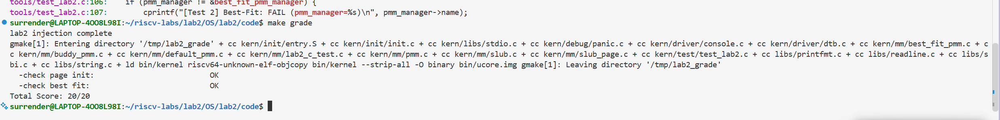
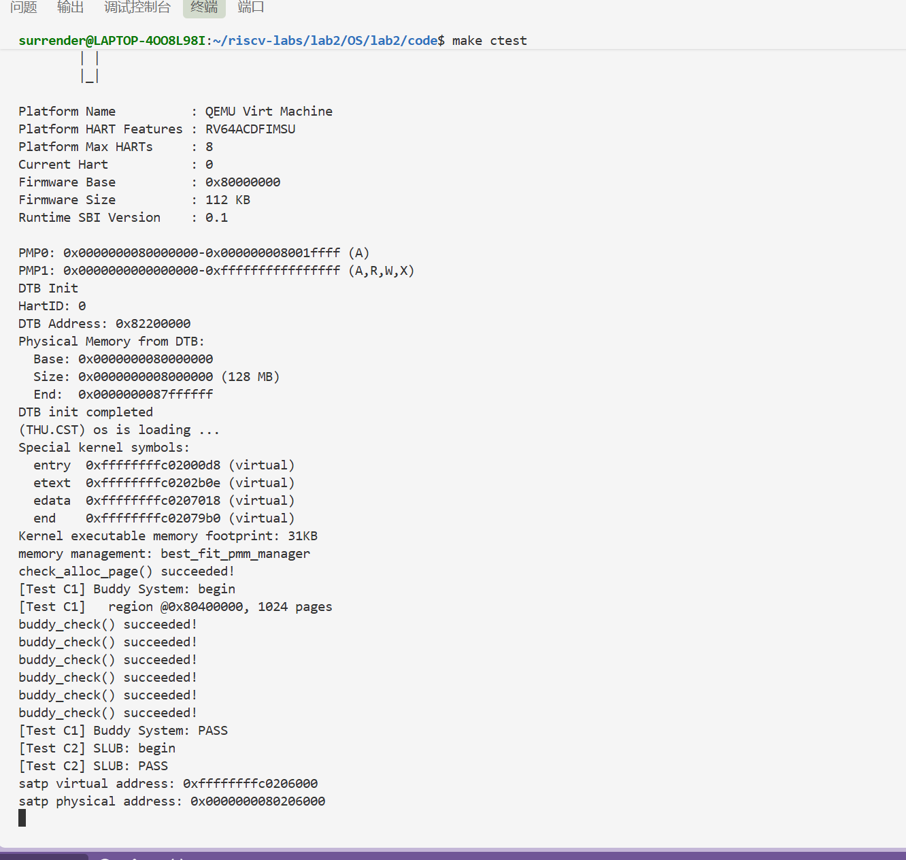
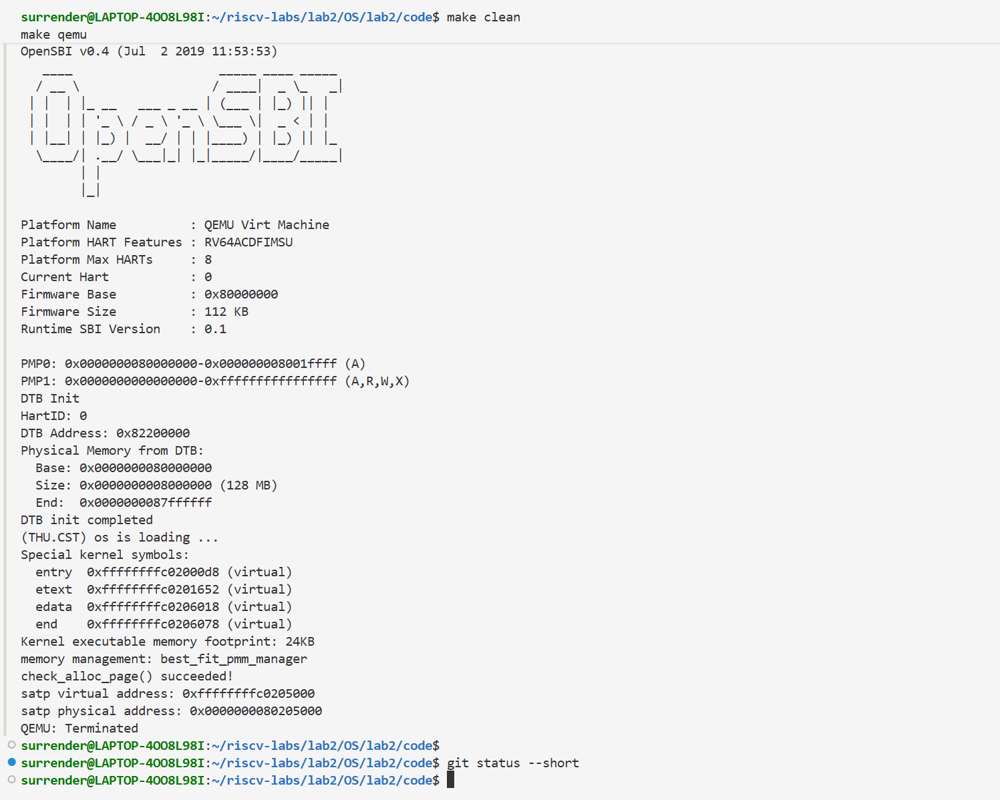

# 操作系统实验报告

## 实验基本信息

| 项目 | 内容 |
|------|------|
| 实验名称 | Lab 2：物理内存和页表 |
| 小组成员 | 2411843-王鹏钧、2412854-于子朔、2412855-张雅程 |
| 实验日期 | 2026-10-22 |
| 报告整理日期 | 2026-10-23 |
| 源码目录 | `OS/lab2/code` |

### 小组分工

| 成员 | 负责的练习/模块 | 主要成果 |
|------|----------------|----------|
| 2411843-王鹏钧 | 功能模块一：物理内存初始化 `page_init()`；协助 SLUB 页级分配 | 完成 DTB 内存探测、Page 描述符数组布局、空闲区登记与边界检查；实现 `kern/mm/slub_page.c` 页级分配层 |
| 2412854-于子朔 | 功能模块二：First-Fit 阅读分析与 Best-Fit 分配器；协助 Buddy 测试 | 实现 `kern/mm/best_fit_pmm.c` 与 `best_fit_pmm_manager`，在 `init_pmm_manager()` 中切换；参与 Buddy 测试用例的讨论与调试 |
| 2412855-张雅程 | 功能模块三：Buddy System；Challenge：SLUB 对象层；集成与报告 | 从零实现 `kern/mm/buddy_pmm.c` 与 `kern/mm/slub.c`，设计两套自测并接入 `make ctest`，完成报告整合 |

物理内存初始化与 Best-Fit 由官方 `make grade` 检查；Buddy 与 SLUB 由 `make ctest` 自测。按实验题目，物理内存初始化、First-Fit 分析、Best-Fit 和 Buddy 均为必做，物理内存范围获取思考题与 SLUB 为选做 Challenge。原环境日志见 [logs/](logs/)，2026-10-23 本次复核的直接证据见文末调试验证记录及截图。

---


### 三项直接运行证明

- **初始化与 Best-Fit 官方检查：** [20/20 评分截图](images/verification-grade-20261023.png)。
- **Buddy 与 SLUB 自测：** [两项 PASS 截图](images/verification-ctest-20261023.png)。
- **恢复普通内核与最终状态：** [Best-Fit 自检成功、工作区干净截图](images/verification-normal-20261023.png)。

---

## 一、实验目的

1. 理解 RISC-V Sv39 三级页表的组织方式，以及 `satp`、页表项（PTE）标志位与虚实地址转换的关系。
2. 理解内核如何在分页开启后完成物理内存的发现与初始化：从设备树获取内存范围，建立 `struct Page` 描述符数组，把可用页交给物理内存管理器。
3. 理解连续物理内存分配算法：先读懂 First-Fit，再实现 Best-Fit，并比较二者的取舍。
4. 通过从零实现 Buddy System，理解“按 2 的幂分块、分裂与合并”的页级分配方法。
5. 通过实现 SLUB，理解“页级分配 + 对象级分配”的两层内存管理架构。
6. 练习用提示词让 AI 生成符合既有框架约束的内核代码，并用测试而不是“能跑起来”来验证生成结果。

---

## 二、实验环境

### 2.1 软件与工具

| 项目 | 本次实验环境 |
|------|--------------|
| 宿主系统 | Windows，使用 WSL 2 |
| Linux 发行版 | Ubuntu 22.04.5 LTS |
| 内核 | Linux 6.6.87.2-microsoft-standard-WSL2 x86_64 |
| 交叉编译器 | `riscv64-unknown-elf-gcc` 10.2.0（`/usr/bin`） |
| 链接器 | `riscv64-unknown-elf-ld` 2.35.1 |
| 模拟器 | QEMU 6.2.0（Debian `1:6.2+dfsg-2ubuntu6.31`，`/usr/bin/qemu-system-riscv64`） |
| 固件 | QEMU 自带 OpenSBI v0.9，Runtime SBI 0.2 |
| 调试器 | GNU gdb 12.1 |
| 模拟平台 | `virt`，RISC-V 64 位，单 HART，128 MiB DRAM |
| 源码目录 | `OS/lab2/code` |

实际采集的版本与路径记录见 [logs/environment.txt](logs/environment.txt)。

**与 lab1 的差异。** lab1 的构建使用了 `$HOME/opt/riscv` 下的 SiFive 工具链；本次实验的 WSL 中 `riscv64-unknown-elf-gcc` 来自 `/usr/bin`，版本 10.2.0，`riscv64-unknown-elf-ld` 为 2.35.1，能正常编译本实验全部源码。QEMU 为 6.2.0，其自带固件为 OpenSBI v0.9。

**启动参数适配。** 本机实测发现，使用 `-device loader,file=bin/ucore.img,addr=0x80200000` 时，OpenSBI 输出的 `Domain0 Next Address` 仍为 `0x0`，固件不会跳转到内核，终端只停留在固件信息阶段；改为 `-kernel bin/ucore.img` 后 `Domain0 Next Address` 为 `0x80200000`，内核正常执行。lab2 原始 `Makefile` 与评分脚本都使用前一种写法，因此本组在 `Makefile` 的 `qemu`/`debug`/`test`/`ctest` 目标与 `tools/grade.sh` 中统一改为 `-kernel`。这只改变镜像交给固件的方式，不改变内核代码与链接地址。

### 环境记录来源说明

本节 2.1 与第 5 节原日志记录的是报告原有环境（OpenSBI v0.9）；文末 2026-10-23 调试验证截图记录的是本次 WSL 复核环境（OpenSBI v0.4）。两组环境资料分别保留，不将其版本信息混写成本次同一环境。原环境完整日志未随本次报告副本提供，本文本次能够直接核实的运行结果以文末三张截图为准。

### 2.2 AI 工具

| 成员 | AI 编程工具 | 底层模型 | 备注 |
|------|------------|---------|------|
| 2411843-王鹏钧 | Codex 桌面应用 | GPT-6.1 | 辅助 `page_init()` 的 spec 设计与边界检查 |
| 2412854-于子朔 | Codex 桌面应用 | GPT-6.1 | 辅助 Best-Fit 实现与测试分析 |
| 2412855-张雅程 | Codex 桌面应用 | GPT-6 Astra | 辅助 Buddy/SLUB 设计、测试用例与报告整理 |

---

## 三、实验整体逻辑分析

### 3.1 本章节的逻辑主线

本章解决两个层层递进的问题：**内核如何知道并使用物理内存**，以及**如何把物理内存映射进虚拟地址空间**。

内核在 `entry.S` 中用一张 1 GiB 的启动页表把虚拟地址 `0xFFFFFFFFC0000000` 起的区域映射到物理 `0x80000000`，写入 `satp` 后进入高地址虚拟空间执行 `kern_init()`。此时 CPU 已经处于分页模式，但内存管理子系统还没有“记忆”：不知道有多少物理页、哪些页可用、如何分配。于是 `pmm_init()` 依次完成三件事：

```text
pmm_init()
    → init_pmm_manager()   选定一种分配算法（First-Fit / Best-Fit / Buddy）
    → page_init()          探测内存、建立 Page 描述符数组、登记初始空闲区
        → init_memmap()    把空闲页交给选定的分配器
    → check_alloc_page()   用分配器自己的 check() 验证分配/释放是否正确
```

之后 `alloc_pages()/free_pages()` 通过 `pmm_manager` 的函数指针分派到具体算法。Best-Fit 与 Buddy 都是在这条既有链路里“换一个实现”，而 SLUB 则是在页分配之上再加一层对象分配。

### 3.2 功能的逐步实现

1. **修改链接地址并建立启动页表**：`tools/kernel.ld` 的 `BASE_ADDRESS` 改为 `0xFFFFFFFFC0200000`；`entry.S` 构造 `boot_page_table_sv39`，用最后一个页表项把 `0xFFFFFFFFC0000000` 映射到 `0x80000000`（1 GiB gigapage），写 `satp`、执行 `sfence.vma` 后跳转 `kern_init`。
2. **从设备树获取物理内存范围**：`entry.S` 保存 `a0`（hartid）与 `a1`（DTB 物理地址）；`kern_init()` 先 `memset(edata,0,end-edata)`，再 `dtb_init()` 解析 DTB，把 `memory_base/memory_size` 存入全局变量。
3. **选择并初始化分配器**：`init_pmm_manager()` 把 `pmm_manager` 指向某个 `pmm_manager` 实例并调用其 `init()`。
4. **建立页描述符数组并登记空闲区**：`page_init()` 设置 `va_pa_offset`、`npage`、`pages`，把描述符全部标为 reserved，再把“描述符数组之后到内存末尾”的完整页交给 `init_memmap()`。
5. **实现分配算法**：先以 First-Fit 为样板理解“空闲块链表 + 块头 property + 前后合并”，再实现 Best-Fit（找最小够用块）。
6. **扩展到页级分配的另一种实现**：Buddy System 用 2 的幂块和伙伴合并管理页。
7. **扩展到对象级分配**：SLUB 在页分配之上把页切成 8–2048 字节的对象。
8. **验证**：官方 `make grade` 检查 `page_init` 与 Best-Fit 接入；成员 C 另写 `make ctest` 自测 Buddy 与 SLUB。

### 3.3 核心文件与模块

| 文件或模块 | 主要作用 |
|------------|----------|
| `tools/kernel.ld` | 把内核链接到虚拟地址 `0xFFFFFFFFC0200000` |
| `kern/init/entry.S` | 保存 hartid/DTB、建立启动页表、设置 `satp`、切换到高地址栈并跳转 `kern_init` |
| `kern/driver/dtb.c` | 解析 DTB，得到 `memory_base`、`memory_size` |
| `kern/mm/pmm.c` | `pmm_init()`、`page_init()`、`pmm_manager` 分派（`alloc_pages` 等） |
| `kern/mm/pmm.h` | `struct pmm_manager`、`PADDR`、`page2pa/pa2page`、`npage/nbase/va_pa_offset` |
| `kern/mm/memlayout.h` | `struct Page`、`PG_reserved/PG_property`、`free_area_t`、地址上界宏 |
| `kern/mm/default_pmm.c` | First-Fit 参考实现 |
| `kern/mm/best_fit_pmm.c` | Best-Fit 实现与 `best_fit_pmm_manager` |
| `kern/mm/buddy_pmm.c` | Buddy System 实现、`buddy_pmm_manager` 与自测 |
| `kern/mm/slub_page.c` | SLUB 的页级分配层（申请/归还连续页） |
| `kern/mm/slub.c` | SLUB 的对象级分配层与自测 |
| `tools/test_lab2.c`、`tools/inject.py`、`tools/grade.sh` | 官方评分：注入测试、启动 QEMU、匹配 PASS 行 |

---

## 四、实验内容与实现

### 4.1 功能模块一：物理内存初始化（王鹏钧）

#### 任务描述

实现 `static void page_init(void);`（`kern/mm/pmm.c`）。要求根据设备树提供的物理内存信息建立 Page 描述符布局，把排除 OpenSBI、内核镜像和描述符数组占用后的完整空闲页交给当前 `pmm_manager`；成功返回时 `va_pa_offset`、`npage`、`pages` 必须正确，并输出探测到的物理内存范围。

#### 提示词

下面是本任务实际使用的提示词（与 [prompt.md](prompt.md) 一致）：

````text
[PROMPT] 补全 pmm.c 中 //lab2 function1 YOUR CODE 标记处的 page_init 函数

[RELY]
宏/常量：PHYSICAL_MEMORY_OFFSET、PGSIZE、PPN()、ROUNDUP()、PADDR()（依赖 va_pa_offset 先赋值）
全局变量：pages、npage、nbase（= DRAM_BASE/PGSIZE）、va_pa_offset
数据结构：struct Page、PG_reserved、SetPageReserved()、pa2page()/page2pa()
已有函数：init_memmap(base, n)、get_memory_base()/get_memory_size()

[GUARANTEE]
完整的 static void page_init(void) 函数。
必须区分虚拟地址、物理地址、物理页号和 Page 描述符地址，正确处理可管理上界和页面对齐，
确保内核及描述符数组不会进入空闲区；设备树信息无效时应终止初始化，没有可用完整页面时
不得调用 init_memmap()。

[SPECIFICATION]
va_pa_offset = PHYSICAL_MEMORY_OFFSET 必须最先设置
npage = PPN(mem_base + mem_size)，且 npage > nbase
pages = (struct Page *)ROUNDUP((uintptr_t)end, PGSIZE)，必须页对齐且 ≥ end
先将 pages[0 .. npage-nbase) 全部 SetPageReserved 并清 flags/property/ref
空闲区 = PADDR(pages) + ROUNDUP((npage-nbase)*sizeof(struct Page), PGSIZE) 到
mem_base+mem_size，调用 init_memmap(pa2page(free_base), free_nr)，
须满足 0 < free_nr <= npage - nbase
结果需通过 Test 1 的 8 项检查：含 end 的页、含 pages 数组的页保持 reserved，
page2pa/pa2page 往返一致
````

#### 实现与验证

`page_init()` 的关键步骤如下（地址一律先换算到物理地址再比较，避免虚地址与物理地址混用）：

```c
va_pa_offset = PHYSICAL_MEMORY_OFFSET;

mem_base = get_memory_base();
mem_size = get_memory_size();
if (mem_base == 0 || mem_size == 0)
    panic("invalid physical memory information");
if (mem_base != DRAM_BASE)
    panic("unsupported physical memory base");

mem_end = mem_base + mem_size;          /* 并检查无符号加法溢出 */
npage  = PPN(mem_end);                  /* 可管理的物理页号上界 */

pages  = (struct Page *)ROUNDUP((uintptr_t)end, PGSIZE);
page_desc_count = npage - nbase;

for (size_t i = 0; i < page_desc_count; i++) { /* 先全部保留，防止未布局的页被分配 */
    pages[i].flags = 0; pages[i].property = 0; pages[i].ref = 0;
    SetPageReserved(&pages[i]);
}

pages_pa  = PADDR((uintptr_t)pages);
free_base = pages_pa + ROUNDUP(page_desc_count * sizeof(struct Page), PGSIZE);
free_nr   = (mem_end - free_base) / PGSIZE;   /* 向下取整，尾部不足一页不交出 */

init_memmap(pa2page(free_base), free_nr);
```

初始化后的物理内存布局为：

```text
[0x80000000, 0x80200000)  OpenSBI（2 MiB）
[0x80200000, end)         内核镜像
[ROUNDUP(end), ...)       Page 描述符数组（每页一个 struct Page，约 40 B/页）
[free_base, 0x88000000)   可分配的完整物理页
```

在 128 MiB 内存下，`npage = 0x88000`、`nbase = 0x80000`，描述符数组需要 32768 个 `struct Page`（约 1.25 MiB），数组之后按页对齐得到 `free_base`，其后的页交给 Best-Fit。

官方 Test 1 的 8 项检查全部通过（见 5.2）：`va_pa_offset` 正确、`npage` 等于 `PPN(mem_end)`、`pages` 页对齐且位于 `end` 之后、描述符之后确实建立了空闲区、内核尾页与描述符数组所在页仍是 reserved、`page2pa/pa2page` 往返一致。


#### Challenge：如果 OS 无法提前知道可用物理内存范围，怎么办

1. **固件/引导协议递交**：本实验就是这种方式——启动链通过 DTB 向内核提供 `memory` 节点，内核据此解析内存信息；x86 上对应 BIOS `e820`、UEFI Memory Map 或 multiboot 的内存表。
2. **探测硬件寄存器**：若固件没有给内存表，但 OS 知道内存控制器/DRAM 控制器的编程接口，可以读容量寄存器或 SPD 信息得到大小。
3. **受控硬件探测**：仅在已知平台约束、具备异常恢复和内容保护机制时，才考虑受控探测。不能凭读回全 0/全 1 或某次写读成功就确定 RAM 边界；未知地址可能属于设备寄存器、镜像区域或保留内存，不应盲目遍历写入。
4. **设备树/ACPI 静态描述**：嵌入式平台常把内存大小写死在 DTB 或 ACPI 表中，启动时只读解析。

本实验选择方案 1：`dtb_init()` 解析 `/memory` 节点并把 `base/size` 存入全局变量，`page_init()` 再据此计算 `npage`。

---

### 4.2 功能模块二：连续物理内存分配（于子朔）

#### 4.2.1 First-Fit 阅读分析（思考题）

`kern/mm/default_pmm.c` 用一条按物理地址升序的空闲块链表管理内存，块头页的 `property` 记录块长度，`PG_property` 标记“这是空闲块头”。

- **`default_init()`**：`list_init(&free_list)`，`nr_free = 0`。
- **`default_init_memmap(base, n)`**：断言每页 `PageReserved`，清零 `flags/property`、`ref=0`；把 `base->property = n`、`SetPageProperty(base)`、`nr_free += n`；再按物理地址升序把块头插入链表（空表直接插入，否则找到第一个地址更大的块，插在它前面；走到表尾则追加）。
- **`default_alloc_pages(n)`**：`n > nr_free` 直接返回 `NULL`；从表头开始找**第一个** `property >= n` 的块；摘下后若块比请求大，就把剩余部分 `p = page + n` 设为新块头（`property = 原值 - n`）插回原位置；`nr_free -= n`，清掉被分配块的 `PG_property`。
- **`default_free_pages(base, n)`**：断言 `!PageReserved && !PageProperty`，清标志与引用计数，设 `base->property = n`、`SetPageProperty`、`nr_free += n`，按地址序插链；随后**向前合并**（前一块满足 `p + p->property == base` 就吞并 `base`），再**向后合并**（`base + base->property == p` 就吞并后继块）。

因此 First-Fit 的特点是：分配只需顺序扫描、实现简单；但每次都从低地址开始找，低地址区域被反复切碎，高地址的大块长期闲置，容易产生外部碎片，且释放时的合并只处理相邻块。

**First-Fit 的改进空间：**

1. **按块大小分桶**（segregated free lists）：把空闲块按大小区间挂到多条链表，分配时先查对应桶，避免每次全表扫描。
2. **记录“上次分配位置”**（next-fit 思想）：从上次位置继续找，减少低地址反复切分。
3. **块头保存前驱/后继块大小**（boundary tag）：释放时 O(1) 判断相邻块是否空闲，而不必遍历链表。
4. **大小索引**：按大小组织的平衡树可在 O(log k) 内找到最小可用块（k 为空闲块数），这会把选择规则改为 Best-Fit；仅对链表排序，查找最坏仍为 O(k)。若要保留 First-Fit 的地址优先规则，可用按地址组织并维护子树最大空闲块长度的树加速查找。
5. **延迟合并 / 定期整理**：减少频繁合并带来的开销。

#### 4.2.2 Best-Fit 的实现

`kern/mm/best_fit_pmm.c` 保留框架给出的 `basic_check()` 与 `best_fit_check()` 两个测试函数不动，只补全管理器本身：

```c
static free_area_t free_area;
#define free_list (free_area.free_list)
#define nr_free   (free_area.nr_free)

static void best_fit_insert_free_block(struct Page *base);   /* 按地址插链并双向合并 */
static struct Page *best_fit_alloc_pages(size_t n);          /* 选最小够用块 */
static void best_fit_free_pages(struct Page *base, size_t n);

const struct pmm_manager best_fit_pmm_manager = {
    .name = "best_fit_pmm_manager",
    .init = best_fit_init,
    .init_memmap = best_fit_init_memmap,
    .alloc_pages = best_fit_alloc_pages,
    .free_pages = best_fit_free_pages,
    .nr_free_pages = best_fit_nr_free_pages,
    .check = best_fit_check,
};
```

**与 First-Fit 的区别只在 `alloc_pages` 的选择规则**：遍历整条空闲链表，取所有 `property >= n` 的块中 `property` 最小者；命中后若块更大，同样把剩余部分切出来插回原位置。释放路径与 First-Fit 相同：清标志、按地址插链、向前向后各合并一次。

接入方式：在 `kern/mm/pmm.c` 的 `init_pmm_manager()` 中把 `pmm_manager` 指向 `&best_fit_pmm_manager`，这样 `page_init() → init_memmap()` 与后续 `alloc_pages()/free_pages()` 都会走 Best-Fit。

#### 4.2.3 提示词


````text
【背景】
riscv64-ucore lab2，参考实现是 kern/mm/default_pmm.c（First-Fit）。框架在
kern/mm/pmm.h 给出 struct pmm_manager 的六个回调，kern/mm/memlayout.h 给出
struct Page（ref/flags/property/page_link）与 free_area_t。

【任务】
只修改 kern/mm/best_fit_pmm.c 中标有 lab2 / YOUR CODE 的位置，实现完整的
Best-Fit 物理内存管理模块，并定义 best_fit_pmm_manager 完成注册；随后在
kern/mm/pmm.c 的 init_pmm_manager() 中切换到它。

【约束】
1. 文件里已有的 basic_check() 与 best_fit_check() 不得修改，实现必须符合它们
   使用的状态约定（块头 PG_property、property 记录块长度、空闲链表按地址升序）；
2. 分配：在空闲链表中选 property >= n 且最小的块，找不到返回 NULL；
3. 剩余空间要切分成新块头插回原位置，nr_free 正确更新；
4. 释放：断言页未被保留且不是块头，清标志与引用计数，按地址插链，并与前、后
   相邻空闲块合并；
5. 不得改动 default_pmm.c，不得使用 libc，必须通过 -Wall -Werror -std=gnu99。

【输出】
best_fit_pmm.c 的完整实现，以及一句说明：为什么 Best-Fit 需要遍历整条链表。
````

#### 4.2.4 验证

- 官方 Test 2 通过：`pmm_manager == &best_fit_pmm_manager`。
- 启动日志中 `memory management: best_fit_pmm_manager`、`check_alloc_page() succeeded!`，说明 `basic_check()` 与 `best_fit_check()` 的全部断言（三次单页分配、清空链表后 `alloc_page()==NULL`、释放后合并、`free_pages(p0+1,2)` 等碎片场景）都通过。

#### 4.2.5 Best-Fit 的改进空间

1. **查找复杂度**：当前为 O(k)，其中 k 是空闲块数。按大小组织的平衡树可把寻找最小可用块降为 O(log k)；分桶结构可缩小搜索范围，但桶内搜索及维护成本取决于具体实现，不能统一称为 O(log k)。
2. **外部碎片**：当前通过合并物理连续的空闲块减少碎片。被已分配页面隔开的空闲块无法直接合并；紧凑化需要页面迁移及引用或映射更新的额外支持。延迟合并可降低部分释放路径的开销，但可能降低即时大块可用性。
3. **细碎空闲块**：可统计小块分布，评估大小索引等方案。每页 Page 描述符本来就已建立，拆出 1 页不会额外申请描述符。若引入最小拆分阈值并把余页随请求一并分配，则必须记录实际分配长度，使 free_pages 能归还全部页面，否则会造成计数错误或泄漏。
4. **缺少统计与调试接口**：可增加“按大小分布的空闲块直方图”，便于观察碎片程度。

---

### 4.3 功能模块二任务三：Buddy System（必做，张雅程）

#### 任务描述

实验不提供 Buddy 的代码框架与测试函数，要求自行设计：把可用空间划分为 2^n 页的块，实现分裂、分配、释放与合并，并接入现有内核；同时自行设计测试，验证实现正确。

#### 设计

- **常量与结构**：`BUDDY_MAX_ORDER = 15`（最大块 32768 页 = 128 MiB），共 16 个 order；每个 order 一条按物理地址升序的空闲块链表。

```c
struct buddy_free_area {
    list_entry_t free_list;    /* 该 order 的块头链表 */
    size_t nr_free;            /* 该 order 的空闲页数 */
};
static struct buddy_free_area buddy_free_areas[BUDDY_MAX_ORDER + 1];
static size_t buddy_nr_free;   /* 全局空闲页数 */
```

- **块头表示**：不修改 `struct Page`，复用 `property` 存 order、`PG_property` 标记“空闲块头”、`page_link` 挂链表；非块头页的 `flags/property` 均为 0。
- **初始化**：把 `[base, base+n)` 按“绝对页号对齐且剩余空间足够”贪心切成尽量大的 2 幂块逐块插入。这样即使区域起点不是 2 幂对齐（例如 `0x80346`），也不会切出跨越区域边界的伙伴块。
- **分配**：`order = ceil(log2(n))`，从该 order 向上找第一个非空链表；摘下块头后逐级分裂，把后半块插回低一级链表。
- **释放与合并**：把 `n` 还原成 order，伙伴块页号为 `start ^ (1 << order)`；若伙伴空闲且 order 相同就合并，直到不能合并为止。合并后的块头取地址较小者，保持链表按地址升序。
- **两个关键细节**：
  1. **计数**：合并时既要从该级链表中摘下伙伴块，也要从该级计数**和全局计数**中减去；最后插入合并块时再加回。只在最后加、不在中途减，会出现“分配 1 页再释放 1 页、空闲页数却翻倍”的错误。
  2. **区域保护**：合并前检查合并后的整块是否仍在 `init_memmap()` 登记过的区域内，避免把属于其他管理器的相邻空闲页误当伙伴块。

#### 提示词


**Prompt 1：生成 Buddy System 模块并接入**

````text
【背景】
riscv64-ucore lab2，物理内存管理接口是 kern/mm/pmm.h 的 struct pmm_manager
（init / init_memmap / alloc_pages / free_pages / nr_free_pages / check）。
可用资源：struct Page（ref/flags/property/page_link）、PG_property 相关宏、
libs/list.h、page2pa/pa2page/page2ppn、npage/nbase/pages/va_pa_offset、
assert/panic/cprintf、set_page_ref。参考实现是 default_pmm.c。

【任务】
新建 kern/mm/buddy_pmm.c 与 buddy_pmm.h，从零实现伙伴系统，并定义
const struct pmm_manager buddy_pmm_manager 完成注册。不要修改 struct Page、
不要改动 default_pmm.c / best_fit_pmm.c，也不要把 init_pmm_manager() 的默认值改掉。

【要求】
1. 最大块 2^15 页，每个 order 一条按物理地址升序的空闲链表；
2. init_memmap 要能处理起点不是 2 的幂对齐的区域，只切出对齐且不越界的块；
3. alloc_pages(n) 把 n 向上取整到 2 的幂，从最小够用块分裂，支持任意 n；
4. free_pages(base, n) 按同样规则还原 order，与 start^(1<<order) 的伙伴块逐级合并；
5. 维护每级页数与全局页数，保证任何时刻 sum(各级) == 全局；
6. 记录 init_memmap 登记过的区域，合并只允许发生在同一区域内部；
7. check() 校验块头标志、order、2^order 对齐、各级页数与总和；
8. 只用内核头文件，通过 -Wall -Werror -std=gnu99。

【输出】
两个文件的完整内容，并说明：为什么 init_memmap 要按“对齐且不越界”切块，
以及合并时全局计数器应当如何更新。
````

**Prompt 2：为 Buddy 生成测试**

````text
【背景】
buddy_pmm.c 已实现，但它不能设为默认管理器（官方评分要求 Best-Fit 处于激活
状态），测试也不能破坏当前 pmm_manager 的状态。

【任务】
写 void buddy_self_test(void)（声明放 buddy_pmm.h），用断言完成自测。

【约束】
1. 先向当前 pmm_manager 借 2048 页，取其中 1024 页对齐的一段作为测试区域，
   保证“全部空闲时可以合并成一个 order-10 块”；
2. 直接调用 buddy_pmm_manager 的回调，不切换全局 pmm_manager；
3. 结束时把整段 2048 页的 flags/property/ref 清零后还给当前 pmm_manager；
4. 每个阶段调用 buddy_check()，成功打印一行 PASS。

【必须覆盖】
初始化后页数正确；分配 1 页、分配 3 页（按 4 页记账）；两者不重叠；
剩余不足时整段分配失败；释放后能否合并回单个 order-10 块（用“再分配 1024 页
必须成功且返回区域首地址”反向验证）；耗尽时分配失败；每阶段 check() 通过。

【输出】
完整函数，并说明每个用例能发现哪类实现错误。
````

#### 测试

`make ctest` 运行结果：

```text
memory management: best_fit_pmm_manager
check_alloc_page() succeeded!
[Test C1] Buddy System: begin
[Test C1]   region @0x80400000, 1024 pages
buddy_check() succeeded!
buddy_check() succeeded!
buddy_check() succeeded!
buddy_check() succeeded!
buddy_check() succeeded!
buddy_check() succeeded!
[Test C1] Buddy System: PASS
```

| 用例 | 覆盖的行为 | 为什么能发现错误 |
|------|-----------|------------------|
| 初始化后 `nr_free == 1024` | 区域切分与记账 | 切块或计数错会立刻不符 |
| 分配 1 页、3 页 | 最小分配、向上取整 | 3 页必须按 4 页记账 |
| 分配后整段分配失败 | 耗尽检测 | 剩 1019 页不可能满足 1024 页 |
| 释放后整段分配成功且返回 `base` | 逐级合并 | 只有完全合并成 order 10 才可能成功 |
| 每阶段 `buddy_check()` | 链表、order、对齐、计数一致性 | 漏合并/漏记账都会触发断言 |

第一次运行时正是 `assert(total == buddy_nr_free)` 暴露了前面提到的“合并只减分级计数、没减全局计数”的错误。

#### 改进空间

1. **查找复杂度**：当前从所需 order 向上逐条链表查找，最坏 O(MAX_ORDER)；可用位图把查找降到 O(1) 级别。
2. **空间开销**：每个空闲块依赖 `struct Page.property` 记录 order，需要覆盖全部物理页的描述符数组；位图式伙伴系统只需要 (总页数/8) 字节量级的元数据。
3. **内部碎片**：请求 3 页会占 4 页，最坏浪费接近 50%；小对象应交给上层的 slab/slub。
4. **并发**：当前无锁，多核下需要每 order 一把自旋锁或 per-CPU 页池。

---

### 4.4 Challenge：SLUB 任意大小对象分配（张雅程）

#### 说明

SLUB 采用两层架构：第一层按页申请/归还内存（成员 A 实现的 `kern/mm/slub_page.c`，接口为 `slub_page_alloc(&desc, nr_pages)` 与 `slub_page_free(&desc)`），第二层把页切成固定大小的小对象，按大小分级缓存，从而支持任意大小分配。本实现接受 1–2048 字节请求，按 8–2048 字节的对象类别向上取整；超过上限的请求返回 NULL。

#### 设计

- **大小分级**：8、16、32、…、2048 共 9 级，请求向上取整；`size == 0` 或 `> 2048` 返回 `NULL`。
- **slab 布局**：一个 slab 恰好一页。页首是 `struct slub_slab` 元数据（magic、所属 cache、页描述符、两条链表节点、freelist、空闲/总对象数），其后是等长对象区；空闲对象用自身前 8 字节串成单向链表，不额外占内存。
- **分配**：优先从 `partial`（还有空对象的 slab）取；为空则新建 slab（页层申请一页、逆序串链、挂到 `slabs` 与 `partial`）。取走最后一个对象时把 slab 从 `partial` 摘掉，返回前 `memset` 清零请求字节数。
- **释放**：slab 一定页对齐，把指针按页下取整即得元数据；用 magic、cache 归属、地址区间和对象对齐四重校验拒绝非法指针（返回 `E_INVAL`）。归还后若 slab 从“满”变“有空”则挂回 `partial`；若整个 slab 都空且该级还有别的 slab，就把页还给页层。
- **容量**：128 字节对象每页可放 31 个，因此测试里分配 128 个对象必然跨多个 slab。

#### 提示词

**Prompt 1：生成 SLUB 对象分配模块**

````text
【背景】
riscv64-ucore lab2。页层已经写好：kern/mm/slub_page.h 提供

struct slub_page { struct Page *base; void *addr; size_t nr_pages; list_entry_t link; };
struct slub_page *slub_page_alloc(struct slub_page *page, size_t nr_pages);
int slub_page_free(struct slub_page *page);

它内部调用 alloc_pages/free_pages，addr 是页的虚拟地址。现在要在它之上实现
任意大小对象的分配层，不能修改 slub_page.c。

【任务】
新建 kern/mm/slub.c 与 slub.h，提供：
void *slub_alloc(size_t size);
int   slub_free(void *ptr);       /* 成功 0，非法指针 E_INVAL */
size_t slub_nr_free_objects(void);
size_t slub_nr_slabs(void);

【要求】
1. 大小分级 8..2048（9 级），请求向上取整；0 与超限返回 NULL；
2. 每个 slab 一页：页首元数据，其后等长对象；空闲对象用自身前 8 字节串链；
3. 每级维护 slabs（全部）与 partial（有空对象）两条链表；
4. 分配优先用 partial，没有空闲对象再向页层申请新 slab；
5. 释放时用 magic + cache 归属 + 地址区间 + 对象对齐校验指针；
6. slab 全空且该级 slab 数 > 1 时归还页层，否则挂回 partial 复用；
7. 只用内核头文件，通过 -Wall -Werror -std=gnu99。

【输出】
两个文件的完整内容，并说明：为什么对象指针可以按页对齐反推 slab 元数据，
以及 freelist 嵌在对象内部有什么代价。
````

**Prompt 2：为 SLUB 生成测试**

````text
【背景】
kern/mm/slub.c 已实现，pmm_init() 已完成、页层可用；测试在内核里跑，失败即 panic。

【任务】
写 void slub_self_test(void)，用断言验证对象层，最后打印一行 PASS。

【必须覆盖】
1. 边界：slub_alloc(0) 与 slub_alloc(2049) 返回 NULL；
2. 分级：1/24/200 字节分别落在 8/32/256 字节级，地址 8 字节对齐；
3. 独立性：三个对象互不重叠，写入不同图案后逐字节读回；
4. 跨 slab：连续分配 128 个 128 字节对象，全部非空、两两不同、可写回读；
5. 复用：全部释放后再分配一次必须成功；
6. 最大级：slub_alloc(2048) 成功并可写满；
7. 非法指针：slub_free(NULL) 返回 E_INVAL。

【输出】
完整函数，并说明每个用例能发现哪类错误（分级错、freelist 断链、slab 复用未清
元数据、越界写等）。
````

#### 测试

```text
[Test C2] SLUB: begin
[Test C2] SLUB: PASS
```

| 用例 | 覆盖的行为 | 为什么能发现错误 |
|------|-----------|------------------|
| `slub_alloc(0)` / `(2049)` | 边界与越界 | 分级函数写错会返回非 NULL |
| 1 / 24 / 200 字节 | 多种请求大小 | 成功分配与读写验证接口行为；由于未直接检查 cache 类别，不能单独据此证明每次选择的类别正确 |
| 三对象互写互读 | 不重叠 | freelist 串错会让两个对象指向同一地址 |
| 128×128B | 跨 slab 与增长 | 一页 31 个，必然多次 `slub_grow` |
| 全部释放后再分配 | 释放后继续分配 | 验证释放后仍能成功申请；未断言复用相同地址，也未比较底层空闲页数，不能单独证明实际复用或全部页面归还 |
| `slub_free(NULL)` | 入参校验 | 未判空会直接解引用 |

#### 与 Linux SLUB 的差异、改进方向

1. **没有 per-CPU 缓存**：Linux 每 CPU 有自己的 current slab，多数分配无锁；本实现全走同一条 `partial` 链表，多核必须加锁。
2. **缓存布局尚未调优**：本实现使用统一的 slab 布局，没有针对硬件缓存行和访问模式评估对象布局；可通过测量后调整对象排列与对齐。
3. **size class 粒度粗**：只有 9 级，130 字节的请求会占 256 字节；可增加级数或细分中间档。
4. **无构造函数**：可在 `struct slub_cache` 中挂 `ctor` 指针扩展。
5. **回收策略简单**：只在“整 slab 全空且该级还有别的 slab”时归还页，可改为维护批量归还阈值，降低锁竞争。

---

## 五、测试与验证

### 5.1 编译与启动

`make qemu` 的完整输出见 [logs/qemu-output.txt](logs/qemu-output.txt)，关键片段：

```text
+ cc kern/mm/buddy_pmm.c
+ cc kern/mm/slub.c
+ cc kern/mm/pmm.c
+ ld bin/kernel
riscv64-unknown-elf-objcopy bin/kernel --strip-all -O binary bin/ucore.img

OpenSBI v0.9
Firmware Base             : 0x80000000
Domain0 Next Address      : 0x0000000080200000
Domain0 Next Arg1         : 0x0000000087000000
Domain0 Next Mode         : S-mode

DTB Init
HartID: 0
DTB Address: 0x87000000
Physical Memory from DTB:
  Base: 0x0000000080000000
  Size: 0x0000000008000000 (128 MB)
  End:  0x0000000087ffffff
DTB init completed
(THU.CST) os is loading ...
Special kernel symbols:
  entry  0xffffffffc02000d8 (virtual)
  etext  0xffffffffc0201652 (virtual)
  edata  0xffffffffc0206018 (virtual)
  end    0xffffffffc0206078 (virtual)
Kernel executable memory footprint: 24KB
memory management: best_fit_pmm_manager
check_alloc_page() succeeded!
satp virtual address: 0xffffffffc0205000
satp physical address: 0x0000000080205000
```

| 验证项目 | 实测结果 |
|----------|----------|
| 固件交接 | `Domain0 Next Address=0x80200000`，S 模式 |
| 设备树探测 | base `0x80000000`、size `0x8000000`（128 MB）、end `0x87ffffff` |
| 内核符号 | `entry=0xffffffffc02000d8`、`end=0xffffffffc0206078`（虚拟地址） |
| 当前管理器 | `best_fit_pmm_manager` |
| 分配自检 | `check_alloc_page() succeeded!` |
| 启动页表 | `satp` 虚拟 `0xffffffffc0205000`、物理 `0x80205000` |

内核初始化结束后进入 `while (1)` 无限循环，因此日志末尾的 `terminating on signal 15` 与 `make: *** Error 124` 是测试脚本到时关闭 QEMU 的记录，不是内核崩溃或编译失败。

### 5.2 makegrade评分

`make grade` 会在临时副本中注入 `tools/test_lab2.c`，重新编译后在 QEMU 中运行，匹配两行 PASS：

```text
lab2 injection complete
...
  -check page init:                          OK
  -check best fit:                           OK

Total Score: 20/20
```

完整日志见 [logs/grade-output.txt](logs/grade-output.txt)。

### 5.3 测试

`make ctest` 使用 `-DLAB2_C_TEST` 重新编译（该目标先 `clean`，避免复用默认构建的目标文件），`pmm_init()` 末尾调用 `lab2_c_self_test()`：

```text
[Test C1] Buddy System: begin
[Test C1]   region @0x80400000, 1024 pages
buddy_check() succeeded!   （×6）
[Test C1] Buddy System: PASS
[Test C2] SLUB: begin
[Test C2] SLUB: PASS
satp virtual address: 0xffffffffc0206000
satp physical address: 0x0000000080206000
```

完整日志见 [logs/ctest-output.txt](logs/ctest-output.txt)。`make ctest` 结束时同样因为 QEMU 被 `timeout` 关闭而返回 `Error 124/2`，自测本身已在此之前输出 PASS。

### 5.4 截图与日志附件


| 附件 | 内容 |
|------|------|
| [环境记录](logs/environment.txt) | 工具链、QEMU、GDB 的实际版本与路径 |
| [QEMU 启动日志](logs/qemu-output.txt) | 编译、固件交接、DTB 探测与内核启动输出 |
| [评分日志](logs/grade-output.txt) | `make grade` 的完整输出（20/20） |
| [自测日志](logs/ctest-output.txt) | `make ctest` 的完整输出（Buddy/SLUB PASS） |


---

## 六、实验总结与收获

### 6.1 与操作系统原理的对应关系

| 实验知识点 | 对应 OS 原理 | 含义、关系与差异 |
|------------|-------------|-----------------|
| Sv39 三级页表、`satp`、PTE 标志位 | 分页与地址转换 | 实验实现了“建立页表并开启分页”的最小闭环；真实 OS 还要处理缺页、权限与多地址空间切换 |
| 启动页表的 1 GiB gigapage | 大页映射 | 用一个叶子页表项映射 1 GiB，减少启动期页表；真实内核会在运行时把大页拆成小页 |
| TLB 与 `sfence.vma` | 地址转换缓存 | 实验中只执行一次刷新；真实 OS 每次修改页表都要考虑 TLB 一致性 |
| DTB 内存探测 | 硬件发现/引导协议 | 固件把内存布局交给内核，相当于 x86 的 e820/UEFI 内存表 |
| `struct Page` 数组 | 物理页框管理 | 每页一个描述符是最直观的做法；Linux 用 `struct page` + `mem_map`，也有位图式管理 |
| First-Fit / Best-Fit | 连续内存分配 | 实验在页粒度上实现；真实内核的伙伴系统是为了降低外部碎片 |
| Buddy System | 页框分配器 | 实验实现了分裂/合并与区域保护；Linux 还加了 per-CPU 页池、迁移类型与反碎片 |
| SLUB | slab 分配器 | 实验实现了“页 + 对象”两层结构与内嵌 freelist；完整内核还涉及并发、按 CPU 缓存及更完整的对象生命周期管理 |
| `pmm_manager` 函数指针表 | 面向对象/策略模式 | 用函数指针把“策略”与“框架”分离，是本实验最值得借鉴的工程手法 |

### 6.2 本实验尚未涉及的重要内容

1. 进程与线程管理：创建、调度、上下文切换与生命周期。
2. 缺页异常、按需分页与页面置换（本实验的页表是一次性建立好的）。
3. 用户态与系统调用：本实验的内核始终运行在 S 模式，没有用户程序。
4. 多核与并发：实验为单 HART，分配器未加锁；真实内核需要 per-CPU 缓存或自旋锁。
5. 文件系统与设备驱动：只用到 SBI 控制台与 DTB。
6. 内存热插拔、NUMA、内存压缩等高级内存管理特性。

### 6.3 AI 协作开发经验

1. **spec 比“请帮我写”更重要**。`page_init` 的提示词里写清了“先设 `va_pa_offset`”“`npage = PPN(mem_end)`”“描述符全部先 reserved”“尾部向下取整”这些可检查的约束，生成结果一次就能过官方 8 项检查；反过来说，凡是没写进 spec 的细节（比如“要打印内存范围”），AI 也不会主动做。
2. **测试是提示词的一部分**。Buddy 的第二次提示词专门用来生成测试，结果第一次运行就抓出了“合并时漏减全局计数”的 bug——如果没有 `assert(total == buddy_nr_free)`，这个错误会一直潜伏到内存被慢慢算错才暴露。
3. **不要相信“能编译”**。本实验最初的 `make grade` 一直是 0 分，但原因不是代码，而是 QEMU 启动参数让内核从未执行；只有把 QEMU 日志、串口输出和评分脚本一起看，才能区分“代码错”和“环境错”。
4. **区分事实与推断**。报告中给出的地址（`entry=0xffffffffc02000d8`、`satp=0x80205000`）都来自实际日志；而“Best-Fit 比 First-Fit 碎片更少”属于分析推断，没有在本实验中用碎片率数据验证。
5. **让 AI 解释失败，而不是让它猜**。把完整报错、日志和源码片段一起提供，比只描述“跑不通”有效。本组分别使用官方评分检查初始化与 Best-Fit，使用独立 ctest 自测 Buddy 与 SLUB。

### 6.4 小组协作与分工说明

- 王鹏钧负责 `page_init()` 与 `slub_page.c`，是把“固件给的内存信息”变成“内核可管理的页”的关键一环，也是后续所有分配器的前提。
- 于子朔负责 Best-Fit，并在 First-Fit 的阅读分析中给出了“按大小分桶、boundary tag”等改进方向；Best-Fit 与 First-Fit 共用同一套空闲链表约定，因此两者的实现可以互相对照。
- 张雅程负责 Buddy 与 SLUB，并在集成阶段统一了构建入口（`make ctest`）与报告材料。
- 三人的代码最终都在 `lab2-c` 分支上按模块分步提交，每个阶段打了 git 标签（`pre-c-baseline`、`c-tooling`、`c-buddy-slub`、`c-report`、`c-done`），出现问题时可以回退到任意一个已验证的检查点。

---

## 附录：报告相关文件

| 文件 | 说明 |
|------|------|
| [prompt.md](prompt.md) | 成员 A 的 `page_init` 提示词原文 |
| [member-c-plan.md](member-c-plan.md) | 成员 C 的任务拆解、测试矩阵与 git 工作流 |
| [logs/](logs/) | 环境记录与三份运行日志 |
| [images/test_result.png](images/test_result.png) | `make grade` / `make ctest` 结果图 |

<!-- LAB2_VERIFICATION_20261023_BEGIN -->
## 调试验证记录（2026-10-23）

### 验证环境与代码版本

本次验证在 Windows 的 WSL Ubuntu 22.04 中进行，使用 RISC-V 交叉编译工具链和 QEMU Virt Machine。启动信息显示 OpenSBI v0.4、128 MiB 物理内存，设备树报告内存起点为 `0x80000000`，末端排他地址为 `0x88000000`。验证开始时，本地 `main` 与 `origin/main` 均指向提交 `602690a`。

### 官方评分检查

在 `lab2/code` 目录执行 `make grade`，编译和评分均正常完成，结果如下：

```text
-check page init: OK
-check best fit:  OK
Total Score: 20/20
```

该结果确认实验评分中的物理页初始化和 Best-Fit 检查通过。Buddy、SLUB 文件参与编译不代表其行为自测已经运行，因此另行执行扩展测试。



### Buddy System 与 SLUB 扩展自测

执行 `make ctest`。该入口先清理旧目标文件，再使用 `LAB2_C_TEST` 编译选项构建内核，在启动过程中依次调用 `buddy_self_test()` 和 `slub_self_test()`。实际输出为：

```text
check_alloc_page() succeeded!
[Test C1] Buddy System: begin
[Test C1]   region @0x80400000, 1024 pages
buddy_check() succeeded!
[Test C1] Buddy System: PASS
[Test C2] SLUB: begin
[Test C2] SLUB: PASS
```

运行中多次输出 `buddy_check() succeeded!`，上面仅保留一行作为摘要。

#### Buddy 自测覆盖与有效性

| 检查内容 | 测试方式及其验证作用 |
| --- | --- |
| 初始化与最小分配 | 初始化 1024 页测试区，申请 1 页，检查返回范围、块首空闲标记、引用计数和空闲页数。 |
| 非二次幂请求 | 申请 3 页后检查空闲总数累计减少 5 页，验证该请求实际占用 4 页，加上此前申请的 1 页。 |
| 空间不足 | 已有分配未释放时，申请整个 1024 页区域应返回 NULL。 |
| 释放与逐级合并 | 释放 3 页请求和 1 页请求后检查空闲计数恢复，再申请整个 1024 页并检查返回原区域起点；整区重新申请能够检验释放块是否重新合并为可用大块。 |
| 耗尽与回收 | 整区分配后空闲计数为 0，额外申请 1 页失败；释放整区后计数恢复。 |
| 与当前管理器配合 | 自测从当前物理内存管理器申请 2048 页，在其中选择对齐的 1024 页测试区；结束时清理描述符状态，并将原申请区域归还。 |

本次普通内核仍选择 `best_fit_pmm_manager`。Buddy 在从 Best-Fit 申请的独立区域中接受测试，本次结果不表示已经将 Buddy 切换为整个内核的默认分配器。自测未明确覆盖地址相邻但不互为伙伴的专门反例、随机分配序列或错误释放参数，报告不将这些列为已验证内容。

#### SLUB 自测覆盖与有效性

| 检查内容 | 测试方式及其验证作用 |
| --- | --- |
| 请求边界 | 0 字节及超过 `SLUB_MAX_OBJECT` 的请求返回 NULL；最大允许大小可成功申请、写入和释放。 |
| 对象大小分类 | 分别申请 1、24、200 字节对象，检查申请成功，覆盖多个对象大小类别。 |
| 数据完整性 | 向对象写入不同字节模式后逐字节读回，检查被测对象之间没有出现写入干扰。 |
| 多 slab 与对齐 | 批量申请 128 字节对象，检查 slab 数至少为 2，检查地址满足 `SLUB_ALIGN` 对齐，并逐对检查返回地址不同。 |
| 批量释放 | 为批量对象写入序号，释放前读回检查，再逐个确认释放返回成功。 |
| 释放后再次申请 | 批量释放后再次申请和释放 128 字节对象成功，验证释放后仍能继续提供对象。 |
| 空指针释放 | `slub_free(NULL)` 返回 `E_INVAL`。 |

上述测试未检查释放前后底层物理空闲页总数是否恢复，因此不能据此断言所有 slab 页面都已归还底层分配器。重复释放、非法指针释放、所有大小类别边界及资源耗尽后的状态一致性也不属于当前截图所示自测的已确认覆盖范围。



### 恢复普通构建并检查启动

扩展测试结束后退出 QEMU，执行：

```bash
make clean
make qemu
```

清理是为了避免普通构建复用带有 `LAB2_C_TEST` 选项的目标文件。普通内核启动后输出：

```text
memory management: best_fit_pmm_manager
check_alloc_page() succeeded!
satp virtual address: 0xffffffffc0205000
satp physical address: 0x0000000080205000
```

本次普通启动没有出现 `[Test C1]`、`[Test C2]`，与普通构建未启用扩展自测的预期一致。使用 `Ctrl+A` 后按 `X` 主动退出 QEMU，随后执行 `git status --short` 没有输出，确认验证结束时工作区干净。终端中的 `QEMU: Terminated` 为主动退出信息。



### 验证结论

本次官方评分为 20/20，Buddy 与 SLUB 现有自测均显示 PASS，清理后普通内核仍能正常启动并通过 Best-Fit 自检。验证过程中未发现编译错误、断言失败或内核 panic。结论限定于上述测试覆盖的行为；本次未执行 GDB 单步调试，也未将未执行的边界或压力测试列为通过项。
<!-- LAB2_VERIFICATION_20261023_END -->
