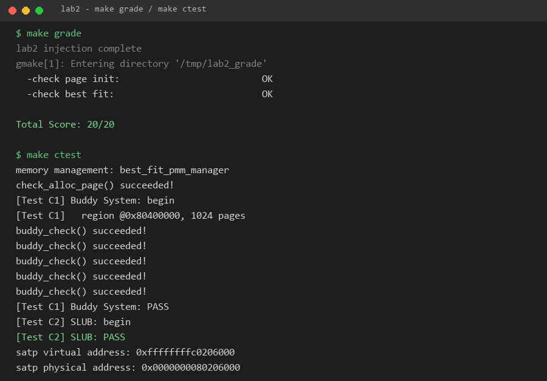

# 操作系统实验报告

## 实验基本信息

| 项目 | 内容 |
|------|------|
| **实验名称** | Lab 2: 物理内存和页表 |
| **小组成员** | 2411843-王鹏钧、2412854-于子朔、2412855-张雅程 |
| **完成日期** | YYYY-MM-DD |

### 小组分工

练习如何分工？

| 成员 | 负责的练习/模块 |
|------|----------------|
| 2411843-王鹏钧 | 功能模块一：物理内存初始化功能|
| 学号2-姓名2 | [练习或模块名称] |
| 学号3-姓名3 | [练习或模块名称] |

实验报告如何分工？

---

## 一、实验目的

<!-- 说明本次实验的主要目标和预期成果 -->

本实验的主要目的是：

1. [目的1：建立物理页描述符并将可用页面交给物理内存管理器]
2. [目的2：实现并接入 Best-Fit 分配器]
3. [目的3：通过 Buddy System 和 SLUB 扩展任务进一步理解页级分配与任意大小内存对象分配]

---

## 二、实验环境

你们使用的 AI 工具

| 成员 | AI 编程工具 | 底层模型 | 备注 |
|------|------------|---------|------|
| 2411843-王鹏钧 | Codex 桌面应用 | GPT-6.1 |  |
| 2412854-于子朔 | Codex 桌面应用 | GPT-6.1 |  |
| 2412855-张雅程 | Codex 桌面应用 | GPT-6 Astra |  |

**说明：**
- **AI 编程工具**：指具体使用的终端工具、编辑器插件、桌面应用或浏览器界面
- **底层模型**：指该工具使用的大语言模型及版本

---

## 三、实验整体逻辑分析

### 2.1 本章节的逻辑主线

[请用自己的话描述本章实验的核心主线，例如：
- 本章围绕哪个核心主题展开？（例如：用户进程管理、虚拟内存、文件系统等）
- 整个实验解决什么问题？（例如：如何让用户程序运行在操作系统之上）]

### 2.2 功能的逐步实现

[说明本章实验是按照什么顺序逐步实现各个功能的，以及为什么要按这个顺序，例如：

1. 首先实现**功能A** → 为什么首先实现这个？（例如：建立系统调用接口是后续所有用户态功能的基础）
2. 接着再完善**功能B** → 为什么接着实现这个？（例如：有了系统调用后，需要能够加载和启动第一个用户进程）
3. 然后完成**功能C** → 为什么然后实现这个？（例如：有了第一个进程后，需要实现进程复制功能）
4. 最后补充了**功能D** → 为什么最后实现这个？（例如：最后完善进程退出和清理机制，形成完整闭环）]

---

## 四、实验内容与实现

<!-- 
说明：本部分按照 exercises 文档中的练习顺序组织
每个功能模块或者练习中可能包含多项任务，请根据实际情况调整
-->

### 功能模块：[物理内存初始化功能]

**负责人：** [2411843-王鹏钧]

#### 模块功能描述

**需要实现/修改的函数：**

```c
static void page_init(void); (kern/mm/pmm.c)
```

**功能说明：**


- 作为内核物理内存管理的总入口和抽象层：在 kern_init 启动早期调用 pmm_init()，探测物理内存、建立 struct Page 描述符数组和空闲页链表，是整个内存管理子系统（后续分页、缺页、用户进程）的基础
- 主要处理内存探测：从设备树（DTB）获取物理内存基址/大小，计算 npage（内存末端页号）。统一分配/释放入口：为上层屏蔽首次适配、最佳适配、伙伴系统等不同算法的差异；check_alloc_page 做自检
- init_pmm_manager() 选定某个算法实例（如 best_fit_pmm_manager），并调用它的 init() 初始化内部链表/位图

#### 最终提示词

以下是经过迭代优化后，最终成功实现该功能的提示词：

````markdown
[PROMPT] 补全 pmm.c中//lab2 function1 YOUR CODE 标记处的 page_init 函数

[RELY]

宏/常量：PHYSICAL_MEMORY_OFFSET、PGSIZE、PPN()、ROUNDUP()、PADDR()（依赖 va_pa_offset 先赋值）
全局变量：pages、npage、nbase（= DRAM_BASE/PGSIZE）、va_pa_offset
数据结构：struct Page、PG_reserved、SetPageReserved()、pa2page()/page2pa()
已有函数：init_memmap(base, n)、get_memory_base()/get_memory_size()
[GUARANTEE] 

完整的 static void page_init(void) 函数
[SPECIFICATION]

va_pa_offset = PHYSICAL_MEMORY_OFFSET 必须最先设置
npage = PPN(mem_base + mem_size)，且 npage > nbase
pages = (struct Page *)ROUNDUP((uintptr_t)end, PGSIZE)，须页对齐且 ≥ end
先将 pages[0..npage-nbase) 全部 SetPageReserved 并清 flags/property/ref
空闲区 = PADDR(pages) + ROUNDUP((npage-nbase)*sizeof(struct Page), PGSIZE) 到 mem_base+mem_size，调用 init_memmap(pa2page(free_base), free_nr)，须满足 0 < free_nr <= npage - nbase
结果需通过 Test 1 的 8 项检查：含 end 的页、含 pages 数组的页保持 reserved，page2pa/pa2page 往返一致]
````

**硬件的可用物理内存范围获取方法** 

OS 可以在启动时通过固件或引导程序提供的硬件信息获取可用物理内存范围。读取设备树的 memory 节点，获得内存基址和大小；也可以由 BIOS/UEFI 提供内存映射，或通过引导协议把内存区域列表传给内核。另外如果固件没有提供内存映射，但OS知道当前运行的硬件架构，也可以直接查询内存控制器


### 练习：[练习标题]

**负责人：** [学号-姓名]

[按照练习的具体要求进行解答]

---

### Challenge：[Challenge标题]

**负责人：** [学号-姓名]

[按照Challenge的具体要求进行解答]

---

## 五、测试与验证

<!-- 根据该实验的具体情况，提供完整的测试运行截图，应包含：
- 编译及运行成功的输出（make qemu），可能有多个
- 测试通过的结果（make grade），只有一个
-->

**测试截图：**



---

## 六、实验总结与收获

### 对操作系统的理解

1. 列出你们认为本实验中重要的知识点，以及与对应的 OS 原理中的知识点，并简要说明二者的含义、关系和差异
2. 列出你们认为 OS 原理中很重要、但在本实验中没有对应上的知识点

### AI 协作开发的经验

[写出你们在与 AI 协作过程中实际收获的经验或者感悟]

---

