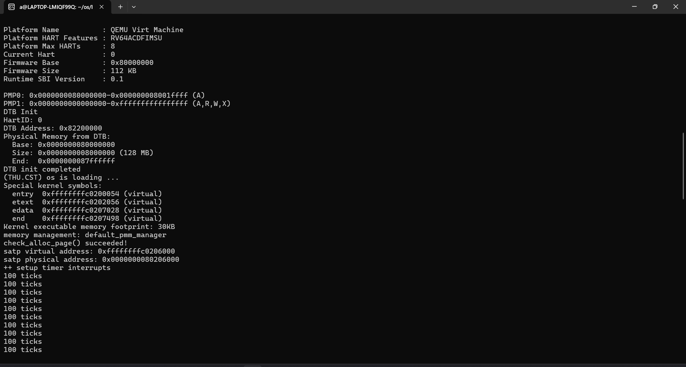
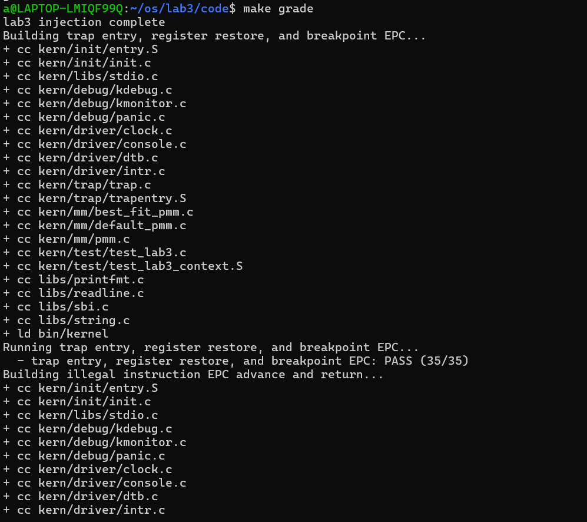
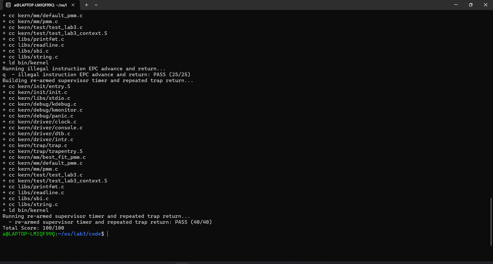

# 操作系统实验报告

## 实验基本信息

| 项目 | 内容 |
|------|------|
| 实验名称 | Lab 3：中断与异常处理 |
| 小组成员 | 2411843 王鹏钧、2412854 于子朔、2412855 张雅程 |
| 实验日期 | 2026-11-03 |
| 源码目录 | `lab3/code` |

### 小组分工

| 成员 | 负责模块 | 主要成果 |
|------|----------|----------|
| 2411843 王鹏钧 | Trap 上下文恢复与入口 | 在 `kern/trap/trapentry.S` 实现 `RESTORE_ALL` 与 `__alltraps`，建立 Trap frame 保存、C 处理及 `sret` 返回流程 |
| 2412854 于子朔 | 中断与时钟处理 | 在 `kern/trap/trap.c` 实现 `interrupt_handler()`：区分中断类型、重设时钟、更新 tick、定期输出并在达到阈值后调用 SBI 关机 |
| 2412855 张雅程 | 异常处理 | 在 `kern/trap/trap.c` 实现非法指令、断点和其他异常的处理，包括输出信息、调整返回 EPC 和异常帧兜底输出 |

---

## 一、实验目的

1. 理解 RISC-V Supervisor 模式下 Trap 的硬件入口、软件上下文保存与特权返回流程。
2. 完成 Trap frame 与 C 语言处理函数之间的衔接，验证通用寄存器及关键 CSR 能够正确恢复。
3. 实现并验证 supervisor timer 中断，包括定时器重设、tick 计数、周期统计输出和达到阈值后的关机。
4. 区分非法指令、断点和其他异常，避免返回时反复执行已经触发异常的指令。
5. 通过 QEMU 中的运行结果及自动评分用例检查中断、异常与 Trap 返回路径。

---

## 二、实验环境

### 2.1 软件与工具

| 项目 | 实际实验环境 |
|------|--------------|
| 宿主系统 | Windows，使用 WSL 2 |
| Linux 发行版 | Ubuntu 22.04 LTS |
| 交叉编译器 | `riscv64-unknown-elf-gcc` 15.1.0（Ubuntu 终端实测） |
| 调试器 | GNU GDB 16.3.90（Ubuntu 终端实测） |
| 模拟器 | QEMU 4.1.1（终端版本输出已确认） |
| 固件 | QEMU 默认 OpenSBI |
| 模拟平台 | `virt`，RISC-V 64 位，单 HART，128 MiB DRAM |
| 评分结果 | `make grade` 100/100（由运行者确认） |

实验环境说明：指导书示例列出 SiFive GCC-Metal 10.2.0 和 GDB-Metal 10.1.0；本次实际版本记录以组员 Ubuntu 终端输出为准。实验要求指定的 QEMU 4.1.1 已确认使用。

### 2.2 AI 辅助工具记录

| 成员 | 工具及模型 |
|------|------------|
| 2411843 王鹏钧 | Claude Code、Claude Opus 5.5|
| 2412854 于子朔 | Codex GPT6.1  |
| 2412855 张雅程 | Codex GPT6.1 |

---

## 三、实验整体逻辑分析

### 3.1 本章节的逻辑主线

实验按“保存 Trap 上下文、进入处理函数、处理 Trap 原因、恢复上下文并返回”的顺序组织。硬件收到中断或异常后，保存特权状态并跳转至 `stvec` 指向的入口；汇编入口保存通用寄存器并建立 `struct trapframe`；C 层根据 `scause`（本实验中保存为 `tf->cause`）分类处理；处理结束后，汇编从 Trap frame 恢复寄存器和返回状态，最后执行 `sret`。

时钟中断是可重复发生的外部事件：初始化时设置第一个事件，每次进入 supervisor timer 处理分支后都要重新设置下一个事件。异常则要求根据原因执行不同动作；对于非法指令和断点，除了报告 EPC，还要把 EPC 移过触发异常的指令，否则返回后会重新执行同一指令。

### 3.2 功能的逐步实现

1. 检查 `SAVE_ALL` 写入的 Trap frame 布局，并实现与其对应的 `RESTORE_ALL`。
2. 在 `__alltraps` 中将 Trap frame 地址放入 `a0`，调用统一的 C 入口 `trap()`。
3. 在 `trap_dispatch()` 中根据 `scause` 最高位区分中断和异常，分别调用 `interrupt_handler()` 与 `exception_handler()`。
4. 在时钟驱动初始化 timer 并开启 supervisor 中断；在中断处理函数中重设时钟、计数并按要求输出或关机。
5. 对非法指令和断点按指令编码长度更新 EPC；对其余异常输出完整 Trap frame。
6. 使用 QEMU 运行及仓库评分脚本验证上下文、异常返回与重复时钟中断。

### 3.3 核心文件与模块

| 文件 | 职责 |
|------|------|
| `kern/trap/trapentry.S` | 保存和恢复通用寄存器及特权状态；建立 Trap frame 并调用 `trap()` |
| `kern/trap/trap.h` | 定义 `struct pushregs`、`struct trapframe` 及 Trap 相关接口 |
| `kern/trap/trap.c` | 初始化 Trap 入口、打印 Trap frame、分派中断/异常并处理具体原因 |
| `kern/driver/clock.c`、`clock.h` | 初始化 timer，提供 `ticks` 和 `clock_set_next_event()` |
| `libs/sbi.c`、`sbi.h` | 封装 OpenSBI timer 与关机调用 |
| `kern/init/init.c` | 初始化 Trap、内存和时钟，最后开放中断 |
| `tools/test_lab3.c`、`tools/grade.sh` | 注入并运行上下文、异常和持续时钟用例 |

---

## 四、实验内容与实现

### 4.1 功能模块一：Trap 上下文恢复与 Trap 入口

#### 任务与实现

`SAVE_ALL` 将原始栈指针、通用寄存器和 `sstatus`、`sepc`、`sbadaddr`、`scause` 保存到 Trap frame。`RESTORE_ALL` 按相同偏移恢复 `sstatus`、`sepc` 和通用寄存器，最后恢复原始 `sp`；`x0` 为硬连线零，不需要写回。`__alltraps` 把当前 `sp` 作为 Trap frame 地址传入 `trap()`，处理完成后进入 `__trapret` 并通过 `sret` 返回。


#### 提示词

````text
[PROMPT] 实现 kern/trap/trapentry.S 中 RESTORE_ALL 宏和 __alltraps 函数

[CONTEXT]
SAVE_ALL 已在当前栈上建立 36*REGBYTES 的 trapframe，sp 指向其起始地址：
0*: x0，1*: ra，2*: 中断前的 sp，3*~31*: x3~x31
32*: sstatus，33*: sepc，34*: sbadaddr，35*: scause

[TASK]
RESTORE_ALL：
借 t0 中转恢复 sstatus、sepc（32*、33*）
恢复 x1、x3~x31（1*、3~31）
最后恢复 sp（2*），因为它是访问基址
不恢复 x0；sbadaddr/scause 只读，不恢复

__alltraps：SAVE_ALL 之后 mv a0, sp，call trap；返回后顺序执行 __trapret（RESTORE_ALL + sret）

[CONSTRAINTS]
使用 riscv.h 的 LOAD 宏；严格按上述布局；不修改 SAVE_ALL、struct trapframe 和 trap() 定义

[OUTPUT]
生成完整的 RESTORE_ALL 宏定义和 __alltraps 函数中 #lab3 function1 标记后的代码。
````
### 4.2 功能模块二：中断与时钟处理（2412854 于子朔）

#### 任务与实现

`interrupt_handler()` 从 `tf->cause` 提取中断原因，并按 RISC-V 中断原因号分支。对 `IRQ_S_TIMER`，先调用 `clock_set_next_event()` 重新安排下一次时钟事件，再增加 `ticks`；每当 `ticks` 达到 `TICK_NUM` 的整数倍时调用 `print_ticks()` 输出 `100 ticks`。统计输出达到 `SHUTDOWN_AFTER` 次后调用 `sbi_shutdown()`。若固件返回，处理函数进入 `wfi` 循环，避免系统继续运行。

其他已定义的软件、timer 和外部中断分支输出对应类型提示；未知中断输出原因号并调用 `print_trapframe(tf)`。非时钟中断不会改变 tick 计数或 EPC。实现使用 `uintptr_t` 提取最高位中断标志，并以无符号长整数格式打印未知原因，避免把高位原因截断。


#### 提示词

```text
请实现 kern/trap/trap.c 中 interrupt_handler(struct trapframe *tf)，只修改该函数及其所需的头文件引用/宏定义，不修改 exception_handler、trap_dispatch、trap 及其他组员代码。

上下文：tf->cause 来自 RISC-V scause。最高位为 1 表示中断，低位为中断原因号；libs/riscv.h 定义 IRQ_S_TIMER、IRQ_S_SOFT 等常量。kern/driver/clock.h 提供 volatile size_t ticks 和 clock_set_next_event()；libs/sbi.h 提供 sbi_shutdown()。文件已有 TICK_NUM 及 print_ticks()，DEBUG_GRADE 分支输出测试结束信息并调用 panic()。

要求：
1. 对 IRQ_S_TIMER 先设置下一次时钟事件，再将 ticks 增加 1。
2. ticks 每达到 TICK_NUM 的整数倍时调用 print_ticks()；统计输出次数达到 SHUTDOWN_AFTER 后调用 sbi_shutdown()。
3. 如果 SBI 关机调用返回，不得继续返回到正常内核执行流。
4. 对其他已定义中断输出类型提示；未知中断输出原因并调用 print_trapframe(tf)。
5. 不修改 tf->epc，不让非时钟中断误改 ticks；考虑原因号宽度和整数打印格式。
6. 保留原有函数签名和 DEBUG_GRADE 测试行为。

请先检查项目已有宏、接口和输出风格，再给出最小实现，并说明计数边界和关机路径。
```


### 4.3 功能模块三：异常处理（2412855 张雅程）

#### 任务与实现

`exception_handler()` 根据 `tf->cause` 处理非法指令异常和断点异常。处理时输出包含 EPC 的提示，并由 `trap_insn_length()` 检查指令低两位：低两位不为 `11` 时按 16 位压缩指令前进 2 字节，否则按本实验常见 32 位指令前进 4 字节。该处理可以避免返回后再次执行同一条非法指令或 `ebreak`。


#### 提示词

````text
[PROMPT] 实现 kern/trap/trap.c 中的 exception_handler(struct trapframe *tf)，正确处理非法指令、断点和其他异常，并保证 Trap 返回位置正确。

[CONTEXT]
汇编入口已经保存处理器上下文，并通过 kern/trap/trap.h 中的 struct trapframe 把 Trap 信息传给 trap(struct trapframe *tf)。tf->cause 保存 scause 的异常原因码，tf->epc 保存触发异常的指令地址，tf->status 保存陷入前的 sstatus。kern/trap/trap.c 已有 print_trapframe(tf) 和 trap_in_kernel(tf) 可用；libs/riscv.h 定义了 CAUSE_ILLEGAL_INSTRUCTION 和 CAUSE_BREAKPOINT。

[TASK]
实现：
void exception_handler(struct trapframe *tf);

1. 当 tf->cause == CAUSE_ILLEGAL_INSTRUCTION 时，输出包含 "Illegal instruction at" 及 tf->epc 的诊断信息，然后根据该指令编码推进 tf->epc。
2. 当 tf->cause == CAUSE_BREAKPOINT 时，输出包含 "Breakpoint at" 及 tf->epc 的诊断信息，然后根据断点指令编码推进 tf->epc。
3. 对其他异常调用 print_trapframe(tf) 作为兜底；按本实验接口约定从处理函数正常返回，不修改未知异常的 EPC。
4. 对本实验范围内的压缩和普通指令正确区分 2/4 字节长度，禁止对所有异常无条件固定加 4。

[CONSTRAINTS]
- 保持 exception_handler(struct trapframe *tf) 
- 不修改 interrupt_handler()、trap_dispatch()、trap()、Trap frame 结构体、trapentry.S 或其他组员负责的代码。
- 不修改中断处理逻辑和时钟计数。

````


---

## 五、实验结果

`make grade` 总分为 **100/100**。三个评分项分别检查 Trap 入口/寄存器恢复与断点 EPC、非法指令 EPC 前进和异常兜底、持续 supervisor timer 中断。

确认时钟统计输出 10 次 `100 ticks` 后模拟器正常退出。该输出对应每 100 次时钟中断统计一次，达到 10 次统计后触发 SBI 关机。

| 验证项 | 结果 |
|--------|------|
| Trap 上下文保存/恢复与断点返回 | 通过（整套评分 100/100） |
| 非法指令 EPC 更新及其他异常兜底 | 通过（整套评分 100/100） |
| 连续 supervisor timer 中断，至少到 200 ticks | 通过（整套评分 100/100） |
| 1000 ticks 统计输出与关机 | 通过；观察到 10 行 `100 ticks` 后 QEMU 退出 |






---

## 六、实验总结与思考

### 6.1 实验收获

1. **硬件与软件的职责划分**：RISC-V 硬件保存部分特权状态并跳转到 `stvec`，通用寄存器保存、Trap 分类和返回状态管理由内核软件完成。
2. **Trap frame 布局必须一致**：汇编保存、C 结构体字段和恢复偏移相互依赖。偏移或顺序不一致会破坏寄存器状态或返回地址。
3. **中断处理需要重设事件**：SBI timer 是一次性事件。每次处理时重新设置下一次事件，才能产生连续时钟中断。
4. **EPC 是恢复控制流的关键**：对于需要跳过的同步异常，更新 EPC 的长度必须与触发指令相符；固定增加错误长度可能跳入指令中间或重复触发异常。
5. **评分用例与实际输出结合使用**：自动测试检查特定路径和输出标记，QEMU 串口日志则能确认系统启动、timer 持续运行和关机的实际过程。


---


